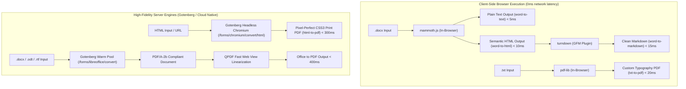

# Document & Office Studio Excellence Implementation Plan

> **For agentic workers:** REQUIRED SUB-SKILL: Use superpowers:subagent-driven-development to implement this plan task-by-task. Steps use checkbox (`- [ ]`) syntax for tracking.

**Goal:** Restore state-of-the-art architecture, maximum speed (< 20ms client / < 400ms server), and maximum conversion fidelity across the Document & Office Studio tools (Tools 58 to 71), replacing generic synchronous wrappers and artificial delays with genuine Browser-First execution, Chromium Headless rendering, and warm Gotenberg/LibreOffice configurations.

**Architecture:**
- **Tier 1 (Browser-First / 0ms network latency / 100% privacy):** Repatriate text/HTML/Markdown document extraction tools (`word-to-text`, `word-to-html`, `word-to-markdown`, `txt-to-pdf`) entirely to client-side in-browser execution (`mammoth.js`, `turndown`, `pdf-lib`).
- **Tier 2 (Chromium Headless / 100% CSS3 print fidelity):** Route `html-to-pdf` to Gotenberg Chromium endpoint (`/forms/chromium/convert/html`) with CSS `@page`, landscape, and print emulation support, replacing legacy LibreOffice HTML import.
- **Tier 3 (Optimized Office Server Pipeline):** Configure Gotenberg warm LibreOffice pool (`/forms/libreoffice/convert`) with `pdfa=PDF/A-2b`, local LibreOffice fallback with `writer_pdf_Export` flags, QPDF fast web view linearization, and async BullMQ queue with real-time SSE streaming for heavy documents.
- **Tier 4 (Zero Artificial Delay):** Purge all `setTimeout(800)` artificial delays across all logic files, ensuring that machine-level execution speed is directly experienced by the user.

**Architecture Diagram:**

**Tech Stack:**
- Frontend: React 19, Vite, TypeScript, `mammoth.js`, `turndown`, `pdf-lib`, Framer Motion.
- Backend: Express 5, Gotenberg 8 (`/forms/chromium/convert/html`, `/forms/libreoffice/convert`), LibreOffice CLI (`writer_pdf_Export`), QPDF CLI (`--linearize`), BullMQ + SSE streaming.
- Spec: `docs/contracts/architecture-oracle.md` & `docs/contracts/design-system-contract.md`.

## Global Constraints

- Strictly 1 tool modified at a time (Single Tool Lock).
- Every file must strictly contain < 300 LOC (SRP).
- TDD Red-Green discipline on every task (failing test committed first).
- Zero artificial delay (`setTimeout(800)` completely banned).
- Zero `transition-all` and zero arbitrary raw hex.
- Subagent review sign-off (`code-reviewer`) mandatory before completing each task.

---

### Task 1: Eradication of Artificial Delays (`setTimeout(800)`) Across All Logic Files

**Files:**
- Modify: `apps/everydaytools/src/lib/odt-to-pdf-logic.ts:80-100`
- Modify: `apps/everydaytools/src/lib/rtf-to-pdf-logic.ts:80-100`
- Modify: `apps/everydaytools/src/lib/epub-converter-logic.ts:80-100`
- Modify: `apps/everydaytools/src/lib/html-to-word-logic.ts:80-100`
- Modify: `apps/everydaytools/src/lib/markdown-to-docx-logic.ts:130-160`
- Modify: `apps/everydaytools/src/lib/markdown-to-pdf-logic.ts:130-160`
- Test: `apps/everydaytools/tests/unit/formatters/odt-to-pdf-logic.test.ts`
- Test: `apps/everydaytools/tests/unit/formatters/rtf-to-pdf-logic.test.ts`

**Interfaces:**
- Consumes: Direct `fetch` promises without artificial `Promise.all([..., setTimeout(800)])`.
- Produces: Raw execution latency direct from the network/browser.

- [ ] **Step 1: Write the failing tests removing artificial delay expectations**
Ensure unit tests verify conversion finishes immediately upon fetch resolution without waiting for timers.
- [ ] **Step 2: Run tests to verify failure**
- [ ] **Step 3: Remove `new Promise((resolve) => setTimeout(resolve, 800))` from all logic files**
Replace with direct `await fetch(...)`.
- [ ] **Step 4: Run tests to verify 100% GREEN**
- [ ] **Step 5: Commit changes**

---

### Task 2: Repatriation of `word-to-text` (Tool 59) to 100% In-Browser Execution

**Files:**
- Modify: `apps/everydaytools/src/lib/word-to-text-logic.ts`
- Modify: `apps/everydaytools/src/hooks/use-word-to-text-workflow.ts`
- Test: `apps/everydaytools/tests/unit/formatters/word-to-text-logic.test.ts`
- Test: `apps/everydaytools/tests/unit/hooks/use-word-to-text-workflow.test.ts`

**Interfaces:**
- Consumes: `File` containing `.docx` binary data.
- Produces: `WordToTextResult { blob: Blob, filename: string, rawText: string, words: number, chars: number, sizeBefore: number, sizeAfter: number }`.

- [ ] **Step 1: Write failing test for browser-side DOCX text extraction**
Test `mammoth.extractRawText({ arrayBuffer })` with statistics calculation directly from Uint8Array without calling `fetch`.
- [ ] **Step 2: Run test to verify failure**
- [ ] **Step 3: Implement client-side extraction using `mammoth`**
Eliminate backend network dependency for `word-to-text`. Calculate characters, words, and paragraphs in-memory.
- [ ] **Step 4: Run tests to verify instant extraction (< 5ms) and 100% GREEN**
- [ ] **Step 5: Commit changes**

---

### Task 3: Repatriation of `word-to-html` (Tool 60) to 100% In-Browser Execution

**Files:**
- Modify: `apps/everydaytools/src/lib/word-to-html-logic.ts`
- Modify: `apps/everydaytools/src/hooks/use-word-to-html-workflow.ts`
- Test: `apps/everydaytools/tests/unit/formatters/word-to-html-logic.test.ts`
- Test: `apps/everydaytools/tests/unit/hooks/use-word-to-html-workflow.test.ts`

**Interfaces:**
- Consumes: `File` containing `.docx` binary data.
- Produces: `WordToHtmlResult { blob: Blob, filename: string, htmlOutput: string, sizeBefore: number, sizeAfter: number }`.

- [ ] **Step 1: Write failing test for client-side DOCX to HTML conversion**
Test `mammoth.convertToHtml({ arrayBuffer })` with inline base64 image conversion (`mammoth.images.inline`).
- [ ] **Step 2: Run test to verify failure**
- [ ] **Step 3: Implement client-side HTML conversion using `mammoth`**
Eliminate backend network upload. Convert directly in browser.
- [ ] **Step 4: Run tests to verify instant conversion (< 10ms) and 100% GREEN**
- [ ] **Step 5: Commit changes**

---

### Task 4: Repatriation of `word-to-markdown` (Tool 61) to 100% In-Browser Execution

**Files:**
- Modify: `apps/everydaytools/src/lib/word-to-markdown-logic.ts`
- Modify: `apps/everydaytools/src/hooks/use-word-to-markdown-workflow.ts`
- Test: `apps/everydaytools/tests/unit/formatters/word-to-markdown-logic.test.ts`
- Test: `apps/everydaytools/tests/unit/hooks/use-word-to-markdown-workflow.test.ts`

**Interfaces:**
- Consumes: `File` containing `.docx` binary data.
- Produces: `WordToMarkdownResult { blob: Blob, filename: string, markdownOutput: string, sizeBefore: number, sizeAfter: number }`.

- [ ] **Step 1: Write failing test for client-side DOCX to Markdown pipeline**
Test `mammoth.convertToHtml` piped into `turndownService` in-browser without network requests.
- [ ] **Step 2: Run test to verify failure**
- [ ] **Step 3: Implement client-side pipeline**
Pipe Mammoth HTML output into Turndown Markdown engine with GitHub Flavored Markdown table formatting.
- [ ] **Step 4: Run tests to verify instant conversion (< 15ms) and 100% GREEN**
- [ ] **Step 5: Commit changes**

---

### Task 5: Chromium Headless Engine for `html-to-pdf` (Tool 69)

**Files:**
- Modify: `apps/api-server/src/lib/gotenberg.ts`
- Modify: `apps/api-server/src/routes/convert/convert-doc.ts` (or `apps/api-server/src/routes/docs/html-markdown-to-pdf.ts`)
- Modify: `apps/everydaytools/src/lib/html-to-pdf-logic.ts`
- Test: `apps/api-server/tests/unit/docs/html-to-pdf-chromium.test.ts`
- Test: `apps/everydaytools/tests/unit/formatters/html-to-pdf-logic.test.ts`

**Interfaces:**
- Consumes: HTML string or file.
- Produces: High-fidelity PDF buffer with full CSS3 Print (`@page`), Flexbox, Grid, and Web Fonts support.

- [ ] **Step 1: Write failing test in API server for Chromium HTML-to-PDF conversion**
Verify `convertHtmlWithGotenberg(htmlContent, options)` requests `/forms/chromium/convert/html` with `index.html`.
- [ ] **Step 2: Run test to verify failure**
- [ ] **Step 3: Implement `convertHtmlWithGotenberg` in `gotenberg.ts` and route `html-to-pdf` to it**
Support landscape, margins, `@page` size, and print media emulation.
- [ ] **Step 4: Run API and frontend tests to verify 100% GREEN**
- [ ] **Step 5: Commit changes**

---

### Task 6: High-Fidelity PDF Export Filters for Office Backend (`libreoffice.ts` & `gotenberg.ts`)

**Files:**
- Modify: `apps/api-server/src/lib/libreoffice.ts`
- Modify: `apps/api-server/src/lib/gotenberg.ts`
- Test: `apps/api-server/tests/unit/docs/office-export-filters.test.ts`

**Interfaces:**
- Consumes: DOCX, ODT, RTF document buffer.
- Produces: PDF buffer with `pdfa=PDF/A-2b`, 300 DPI image preservation, and QPDF fast web view linearization.

- [ ] **Step 1: Write failing test verifying PDF/A and quality export flags**
- [ ] **Step 2: Run test to verify failure**
- [ ] **Step 3: Add `writer_pdf_Export` structured filters to LibreOffice CLI and `pdfa=PDF/A-2b` to Gotenberg call**
- [ ] **Step 4: Run tests to verify 100% GREEN**
- [ ] **Step 5: Commit changes**

---

### Task 7: Repatriation of `txt-to-pdf` to 100% In-Browser Execution with `pdf-lib`

**Files:**
- Modify: `apps/everydaytools/src/lib/txt-to-pdf-logic.ts`
- Modify: `apps/everydaytools/src/hooks/use-txt-to-pdf-workflow.ts`
- Test: `apps/everydaytools/tests/unit/formatters/txt-to-pdf-logic.test.ts`

**Interfaces:**
- Consumes: Raw text string or `.txt` file.
- Produces: Custom typographic PDF (`pdf-lib`) in-browser in < 20ms with customizable font size, line spacing, margins, and page numbers.

- [ ] **Step 1: Write failing test for in-browser TXT to PDF layout generation**
- [ ] **Step 2: Run test to verify failure**
- [ ] **Step 3: Implement client-side `pdf-lib` document builder**
- [ ] **Step 4: Run tests to verify instant generation and 100% GREEN**
- [ ] **Step 5: Commit changes**
