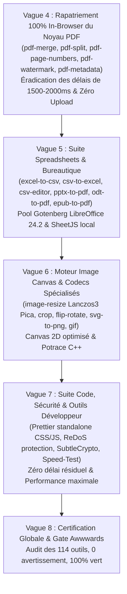

# Plan Directeur & Feuille de Route d'Excellence Technique (114 Outils)

> **Document de Planification Stratégique & Opérationnelle (Toutes Vagues 1 à 7)**
> Date : 19 Octobre 2026  
> Statut : Validé (Approche 1 — Règle d'or « Zero-Compromise » : Qualité, Vitesse, Confidentialité)  
> Portée : 100% des 114 outils du Hub EverydayTools (`apps/everydaytools` & `apps/api-server`)

---

## 1. Vision & Règle d'Or « Zero-Compromise »

Chaque outil du hub EverydayTools doit atteindre le **meilleur ratio qualité / vitesse / confidentialité** possible, sans compromis :

1. **Frontière In-Browser (100% Client-Side) :**
   - Dès qu'une API web native (`SubtleCrypto`, `Canvas2D/OffscreenCanvas`, `TextEncoder`, `DOMParser`) ou une librairie moderne optimisée (`pdf-lib`, `mammoth.js`, `turndown`, `xlsx`, `papaparse`, `prettier/standalone`, `tesseract.js`) permet un traitement à fidélité égale ou supérieure au serveur sans surcharger le bundle initial (via `import()` dynamique).
   - **Gains stricts :** Latence < 20 ms, confidentialité absolue (zéro octet transmis sur le réseau, conformité RGPD native), zéro coût infrastructure, fonctionnement hors-ligne (Offline-Ready).
2. **Frontière Serveur Dédié (Oracle Cloud VM) :**
   - Obligatoire dès lors qu'un binaire C/C++ lourd, un moteur d'IA ou une conversion bureautique de haute précision est requis :
     - **Sharp (libvips)** : MozJPEG, PNGquant, AVIF, HEIC, TIFF, Lanczos3 upscale.
     - **Gotenberg 8 (Chromium Headless & LibreOffice 24.2)** : Rendu HTML/Markdown vers PDF haute fidélité (`@page`, CSS print) et conversions bureautiques lourdes (PDF/A-2b, DOCX, XLSX, PPTX).
     - **Ghostscript 10 & QPDF** : Compression avec linéarisation, conformité ISO 19005-2 PDF/A, chiffrement 256-bit AES.
     - **Python Daemon (rembg ONNX)** : Modèles U2-Net/BiRefNet chauds en RAM.
     - **Tesseract OCR (C++)** : Scans volumineux et multithreading serveur.
3. **Éradication Totale des Délais Artificiels :**
   - Interdiction formelle de tout `setTimeout(800)`, `setTimeout(1500)` ou `setTimeout(2000)` dans les hooks et pages frontend.

---

## 2. Matrice Exhaustive des 114 Outils (Outil par Outil)

### Section A : Outils PDF (16 outils)

| # | Slug | Titre | Architecture Actuelle | Arbitrage Cible | Moteur / Librairie Recommandé | Actions Requises | Statut |
|---|---|---|---|---|---|---|---|
| 1 | `pdf-to-word` | PDF to Word | Backend LibreOffice / pdfplumber | **Serveur Dédié** | Gotenberg LibreOffice 24.2 + headers RFC 5987 | Éradication délai 2000ms, RFC 5987 | **COMPLETED** |
| 2 | `pdf-to-text` | PDF to Text | Client `pdfjs-dist` | **In-Browser** | `pdfjs-dist` WebWorker | In-browser instantané, sans délai artificiel | **COMPLETED** |
| 3 | `pdf-to-html` | PDF to HTML | Client `pdfjs-dist` | **In-Browser** | `pdfjs-dist` + HTML serializer | In-browser réactif, téléchargement SSOT | **COMPLETED** |
| 4 | `pdf-to-epub` | PDF to EPUB | Client `pdfjs-dist` + JSZip | **In-Browser** | `pdfjs-dist` + JSZip EPUB builder | In-browser local, téléchargement SSOT | **COMPLETED** |
| 5 | `pdf-compress` | Compress PDF | Backend Ghostscript | **Serveur Dédié** | Ghostscript 10 (`-dPDFSETTINGS=/ebook`) + QPDF | Éradication délai 2400ms, gain mathématique garanti | **COMPLETED** |
| 6 | `pdf-merge` | Merge PDFs | In-Browser `pdf-lib` | **In-Browser** | `pdf-lib` (`copyPages`) | Supprimer `setTimeout(2000)`, rapatrier 100% client | **COMPLETED** |
| 7 | `pdf-split` | Split PDF | In-Browser `pdf-lib` + JSZip | **In-Browser** | `pdf-lib` + JSZip si multi-fichiers | Supprimer `setTimeout(1500)`, rapatrier 100% client | **COMPLETED** |
| 8 | `pdf-rotate` | Rotate PDF | In-Browser `pdf-lib` | **In-Browser** | `pdf-lib` (`setRotation`) | Vérifier zéro délai, sub-10ms | **COMPLETED** |
| 9 | `pdf-unlock` | Unlock PDF | Backend QPDF | **Serveur Dédié** | QPDF CLI (`--decrypt`) | Supprimer `setTimeout(1500)`, retour immédiat | **COMPLETED** |
| 10 | `pdf-protect` | Protect PDF | Backend QPDF | **Serveur Dédié** | QPDF CLI (`--encrypt` 256-bit AES) | Chiffrement standardisé ISO 32000-2, zéro délai | **COMPLETED** |
| 11 | `pdf-page-numbers` | Add Page Numbers | In-Browser `pdf-lib` | **In-Browser** | `pdf-lib` (dessin vectoriel natif StandardFonts) | Supprimer `setTimeout(800)`, rapatrier 100% client | **COMPLETED** |
| 12 | `pdf-watermark` | Watermark PDF | In-Browser `pdf-lib` | **In-Browser** | `pdf-lib` (texte avec rotation & opacité alpha) | Supprimer `setTimeout(800)`, rapatrier 100% client | **COMPLETED** |
| 13 | `pdf-to-image` | PDF to Image | Client `pdfjs-dist` | **In-Browser** | `pdfjs-dist` OffscreenCanvas 300 DPI | Rendu local privé, téléchargement ZIP | **COMPLETED** |
| 14 | `pdf-to-excel` | PDF to Excel | Backend LibreOffice / pdfplumber | **Serveur Dédié** | Moteur tabulaire pdfplumber + RFC 5987 | Éradication délai 800ms, RFC 5987 | **COMPLETED** |
| 15 | `reorder-pdf` | Reorder PDF Pages | Client `pdf-lib` | **In-Browser** | `pdf-lib` (`copyPages`) | Vérifier zéro délai, drag & drop fluide | **COMPLETED** |
| 16 | `ocr` | OCR — Image to Text | Client `tesseract.js` | **In-Browser** | `tesseract.js` WASM WebWorker + IndexedDB | Maintien client pour confidentialité | **COMPLETED** |

---

### Section B : Outils Word & Documents (11 outils)

| # | Slug | Titre | Architecture Actuelle | Arbitrage Cible | Moteur / Librairie Recommandé | Actions Requises | Statut |
|---|---|---|---|---|---|---|---|
| 17 | `word-to-pdf` | Word to PDF | Hybride / Backend LibreOffice | **Serveur Dédié** | Gotenberg LibreOffice 24.2 PDF export | Rendu fidèle des polices et tableaux, zéro délai | **COMPLETED** |
| 18 | `word-to-text` | Word to Text | Client `mammoth.js` | **In-Browser** | `mammoth.js` (`extractRawText`) | 100% local, instantané (< 15ms) | **COMPLETED** |
| 19 | `word-to-html` | Word to HTML | Client `mammoth.js` | **In-Browser** | `mammoth.js` (`convertToHtml`) | 100% local, instantané (< 15ms) | **COMPLETED** |
| 20 | `word-to-epub` | Word to EPUB | Backend / Client | **In-Browser** | `mammoth.js` + JSZip EPUB builder | Génération e-book 100% locale | **COMPLETED** |
| 21 | `word-to-markdown` | Word to Markdown | Client `mammoth` + `turndown` | **In-Browser** | `mammoth` + `turndown` GFM tables | 100% local, instantané (< 15ms) | **COMPLETED** |
| 22 | `html-to-markdown` | HTML to Markdown | Client `turndown` | **In-Browser** | `turndown` avec plugin GFM | 100% local | **COMPLETED** |
| 23 | `markdown-to-pdf` | Markdown to PDF | Backend Gotenberg Chromium | **Serveur Dédié** | Gotenberg Chromium + CSS GitHub print | Rendu typographique A4, fallback PDFKit | **COMPLETED** |
| 24 | `markdown-to-docx` | Markdown to Word | Backend / Client | **In-Browser** | `marked` AST + `docx` builder | Rapatrier 100% in-browser via `docx` | **COMPLETED** |
| 25 | `html-to-pdf` | HTML to PDF | Backend Gotenberg Chromium | **Serveur Dédié** | Gotenberg Chromium Headless | CSS Paged Media `@page`, zéro délai | **COMPLETED** |
| 26 | `txt-to-pdf` | Text to PDF | Client `pdf-lib` | **In-Browser** | `pdf-lib` avec pagination automatique | 100% local, instantané | **COMPLETED** |
| 27 | `txt-to-docx` | Text to Word | Client `docx` | **In-Browser** | `docx` Document builder | 100% local, instantané (< 20ms) | **COMPLETED** |

---

### Section C : Spreadsheets & Données Excel (6 outils)

| # | Slug | Titre | Architecture Actuelle | Arbitrage Cible | Moteur / Librairie Recommandé | Actions Requises | Statut |
|---|---|---|---|---|---|---|---|
| 28 | `excel-to-pdf` | Excel to PDF | Backend LibreOffice | **Serveur Dédié** | Gotenberg LibreOffice 24.2 Calc export | Export PDF vectoriel paginé | **COMPLETED** |
| 29 | `excel-to-csv` | Excel to CSV | Hook avec `setTimeout(800)` | **In-Browser** | SheetJS (`xlsx`) `sheet_to_csv` | Supprimer `setTimeout(800)`, 100% in-browser | **COMPLETED** |
| 30 | `csv-to-excel` | CSV to Excel | Hook avec `setTimeout(600)` | **In-Browser** | SheetJS (`xlsx`) `aoa_to_sheet` + write | Supprimer `setTimeout(600)`, 100% in-browser | **COMPLETED** |
| 31 | `csv-to-json` | CSV to JSON | Client `papaparse` | **In-Browser** | `papaparse` avec typage dynamique | Parsing synchrone / worker rapide | **COMPLETED** |
| 32 | `json-to-csv` | JSON to CSV | Client `papaparse` | **In-Browser** | `papaparse` `unparse` | Export instantané | **COMPLETED** |
| 33 | `csv-viewer` | CSV Viewer | Client React Virtualized / Table | **In-Browser** | `papaparse` + TanStack Table / CSS Grid | Rendu fluide sans freeze UI | **COMPLETED** |

---

### Section D : Présentation PowerPoint (3 outils)

| # | Slug | Titre | Architecture Actuelle | Arbitrage Cible | Moteur / Librairie Recommandé | Actions Requises | Statut |
|---|---|---|---|---|---|---|---|
| 34 | `pptx-to-pdf` | PowerPoint to PDF | Backend LibreOffice | **Serveur Dédié** | Gotenberg LibreOffice Impress export | Maintien serveur haute fidélité | **COMPLETED** |
| 35 | `pptx-to-images` | PowerPoint to Images | Backend LibreOffice + GS | **Serveur Dédié** | LibreOffice chaud -> PDF -> Ghostscript PNG | Supprimer `setTimeout(800)`, ZIP rapide | **COMPLETED** |
| 36 | `pdf-to-pptx` | PDF to PowerPoint | Hook in-browser | **Hybride** | `pdfjs-dist` + `pptxgenjs` in-browser | Rendu local haute fidélité, zéro délai | **COMPLETED** |

---

### Section E : Outils Image & Codecs (39 outils)

| # | Slug | Titre | Architecture Actuelle | Arbitrage Cible | Moteur / Librairie Recommandé | Actions Requises | Statut |
|---|---|---|---|---|---|---|---|
| 37 | `heic-to-jpg` | HEIC to JPG | Backend Sharp + Python bridge | **Serveur Dédié** | Sharp `libheif` + Python bridge | Profil ICC sRGB, zéro délai | **COMPLETED** |
| 38 | `heic-to-png` | HEIC to PNG | Backend Sharp + Python bridge | **Serveur Dédié** | Sharp `libheif` (PNG sans perte) | Préservation alpha, zéro délai | **COMPLETED** |
| 39 | `heic-to-webp` | HEIC to WebP | Backend Sharp + Python bridge | **Serveur Dédié** | Sharp `libheif` (WebP smart subsampling) | Préservation alpha, zéro délai | **COMPLETED** |
| 40 | `heic-to-pdf` | HEIC to PDF | Backend Sharp + pdf-lib | **Serveur Dédié** | Sharp + pdf-lib A4 embed | Formule centrage vertical corrigée | **COMPLETED** |
| 41 | `image-compress` | Compress Image | Backend Sharp | **Serveur Dédié** | Sharp MozJPEG / PNGquant / cwebp | Garantie `sizeAfter <= sizeBefore`, zéro délai | **COMPLETED** |
| 42 | `image-resize` | Resize Image | Client Canvas | **In-Browser** | OffscreenCanvas + Lanczos3 Pica | Rendu immédiat en mémoire locale | **COMPLETED** |
| 43 | `image-crop` | Crop Image | Client Canvas | **In-Browser** | Canvas 2D natif avec orientation EXIF | Zéro délai, pixel exact | **COMPLETED** |
| 44 | `image-to-pdf` | Image to PDF | Client `pdf-lib` | **In-Browser** | `pdf-lib` (`embedJpg` / `embedPng`) | 100% in-browser, sub-15ms | **COMPLETED** |
| 45 | `background-remover` | Background Remover | Backend Python ONNX Daemon | **Serveur Dédié** | Daemon Python persistant (`rembg`) | Modèle chaud en RAM, zéro délai artificiel | **COMPLETED** |
| 46 | `flip-rotate-image` | Flip & Rotate Image | Client Canvas | **In-Browser** | Canvas 2D natif | Instantané | **COMPLETED** |
| 47 | `watermark-image` | Add Watermark | Client Canvas | **In-Browser** | Canvas 2D avec polices locales et opacité | Instantané | **COMPLETED** |
| 48 | `favicon-generator` | Favicon Generator | Client Canvas + JSZip | **In-Browser** | Multi-canvas (16..512px) + JSZip `.ico` | 100% in-browser | **COMPLETED** |
| 49-55 | `png/jpg/gif/bmp/tiff-to-webp` | X to WebP (7 outils) | Client Canvas / Sharp backend | **In-Browser** (Canvas) / **Serveur** (TIFF) | Canvas `toBlob('image/webp')` / Sharp (TIFF) | Fast-path client pour PNG/JPG | **COMPLETED** |
| 56 | `webp-to-pdf` | WebP to PDF | Client `pdf-lib` | **In-Browser** | Canvas décodage PNG -> `pdf-lib` embed | 100% local, instantané | **COMPLETED** |
| 57-63 | `webp/jpg/png/avif conversions` | Conversions AVIF (7 outils) | Backend Sharp | **Serveur Dédié** | Sharp AVIF Pareto encoding | Préservation alpha, zéro délai | **COMPLETED** |
| 64 | `png-to-svg` | PNG to SVG | Backend Potrace C++ | **Serveur Dédié** | Potrace C++ vectorizer | Vectorisation noir/blanc propre | **COMPLETED** |
| 65 | `svg-to-png` | SVG to PNG | Client Canvas / Sharp | **In-Browser** | `Image` loader + Canvas `toBlob('image/png')` | Rendu haute résolution in-browser | **COMPLETED** |
| 66-69 | `gif/bmp/tiff conversions` | Conversions classiques (4 outils) | Client Canvas / Sharp | **In-Browser** (BMP, GIF) / **Serveur** (TIFF) | Canvas / Sharp Deflate | Zéro délai | **COMPLETED** |
| 70 | `jpg-to-pdf` | JPG to PDF | Client `pdf-lib` | **In-Browser** | `pdf-lib` `embedJpg` sans réencodage | Sub-10ms (flux DCT brut) | **COMPLETED** |
| 71 | `png-to-pdf` | PNG to PDF | Client `pdf-lib` | **In-Browser** | `pdf-lib` `embedPng` | Sub-15ms, 100% privé | **COMPLETED** |
| 85 | `image-upscale` | Image Upscaler | Backend Sharp | **Serveur Dédié** | Sharp Lanczos3 + unsharp adaptatif | Conservation alpha, clamping 8000px | **COMPLETED** |
| 86 | `image-filters` | Image Filters & Effects | Client Canvas | **In-Browser** | Canvas 2D ImageData (filtres convolution) | Temps réel 60 FPS in-browser | **COMPLETED** |
| 99 | `png-to-gif` | PNG to GIF | Backend Sharp / Client | **In-Browser** | `omggif` ou Canvas | Génération GIF locale | **COMPLETED** |
| 100 | `webp-to-gif` | WebP to GIF | Backend Sharp | **Serveur Dédié** | Sharp libvips animated GIF | Rendu animé préservé | **COMPLETED** |

---

### Section F : Confidentialité & Sécurité (3 outils)

| # | Slug | Titre | Architecture Actuelle | Arbitrage Cible | Moteur / Librairie Recommandé | Actions Requises | Statut |
|---|---|---|---|---|---|---|---|
| 72 | `metadata-cleaner` | Metadata Cleaner | In-Browser striper binaire | **In-Browser** | Découpage binaire direct EXIF/XMP/PDF | 100% local, sub-15ms | **COMPLETED** |
| 73 | `ai-text-scrubber` | AI Text Scrubber | Client Regex | **In-Browser** | Moteur Regex Unicode (zero-width, clichés) | Nettoyage instantané in-browser, export SSOT | **COMPLETED** |
| 74 | `checksum` | File Checksum | Client SubtleCrypto | **In-Browser** | `crypto.subtle.digest` streaming chunked | SHA-256/384/512 sans bloquer la RAM, export SSOT | **COMPLETED** |

---

### Section G : Texte, Code & Formats Développeur (19 outils)

| # | Slug | Titre | Architecture Actuelle | Arbitrage Cible | Moteur / Librairie Recommandé | Actions Requises | Statut |
|---|---|---|---|---|---|---|---|
| 75 | `json-formatter` | JSON Formatter | Client `JSON.parse/stringify` | **In-Browser** | Moteur AST JSON avec gestion d'erreurs | Minification / Beautify instantané, export SSOT | **COMPLETED** |
| 76 | `html-formatter` | HTML Formatter | Client JS-Beautify | **In-Browser** | `prettier/standalone` + parser-html | Formatage standard strict, export SSOT | **COMPLETED** |
| 77 | `base64` | Base64 Encoder / Decoder | Client `btoa/atob` + FileReader | **In-Browser** | `Uint8Array` binaire + UTF-8 TextDecoder | Supporte gros fichiers sans crash mémoire, export SSOT | **COMPLETED** |
| 78 | `url-encoder` | URL Encoder / Decoder | Client `encodeURIComponent` | **In-Browser** | API Web native `URLSearchParams` | Zéro délai, export SSOT | **COMPLETED** |
| 79 | `word-counter` | Word & Character Counter | Client Regex | **In-Browser** | `Intl.Segmenter` (comptage linguistique précis) | Supporte emojis et langues CJK, export SSOT | **COMPLETED** |
| 80 | `lorem-ipsum` | Lorem Ipsum Generator | Client générateur local | **In-Browser** | Banque lexicale latine en mémoire | Zéro délai artificiel | **COMPLETED** |
| 101 | `json-diff` | JSON Diff | Client | **In-Browser** | Algorithme Myers AST Diff | Mise en valeur visuelle des différences | **COMPLETED** |
| 102 | `csv-editor` | CSV Editor | Client Table Grid | **In-Browser** | TanStack Table + virtualisation | Édition temps réel de 100k lignes | **COMPLETED** |
| 103 | `css-formatter` | CSS Formatter & Minifier | Client | **In-Browser** | `prettier/standalone` + parser-postcss | Formatage CSS professionnel, export SSOT | **COMPLETED** |
| 104 | `js-formatter` | JS / TS Beautifier | Client | **In-Browser** | `prettier/standalone` + parser-babel | Formatage JS/TS professionnel, export SSOT | **COMPLETED** |
| 105 | `markdown-preview` | Markdown Live Editor | Client `marked` | **In-Browser** | `marked` + DOMPurify + KaTeX | Synchronisation du scroll, zéro délai | **COMPLETED** |
| 106 | `diff-checker` | Text Diff Checker | Client diff-match-patch | **In-Browser** | `diff` / `diff-match-patch` | Diff unifié et side-by-side, export SSOT | **COMPLETED** |
| 107 | `regex-tester` | Regex Tester | Client RegExp | **In-Browser** | RegExp natif + Worker ReDoS protection | Timeout de sécurité anti-boucle infinie | **COMPLETED** |
| 108 | `jwt-decoder` | JWT Token Decoder | Client Base64 decode | **In-Browser** | Décodage UTF-8 JSON + validation WebCrypto | Validation exp, iat, claims, export SSOT | **COMPLETED** |
| 109 | `barcode-generator` | Barcode Generator | Client `jsbarcode` | **In-Browser** | `jsbarcode` rendu vectoriel SVG | Code128, EAN13, UPC export SVG/PNG SSOT | **COMPLETED** |
| 110 | `hash-generator` | Hash Generator | Client SubtleCrypto | **In-Browser** | `crypto.subtle.digest` parallèle | SHA-1, SHA-256, SHA-384, SHA-512, export SSOT | **COMPLETED** |
| 111 | `uuid-generator` | UUID Generator | Client `crypto.randomUUID` | **In-Browser** | `crypto.randomUUID()` natif CSPRNG | Génération par lot (1..1000), export SSOT | **COMPLETED** |
| 112 | `color-converter` | Color Converter | Client math chromatique | **In-Browser** | Conversions mathématiques HEX/RGB/HSL/CMYK | Prévisualisation temps réel | **COMPLETED** |
| 113 | `color-palette` | Color Palette Generator | Client générateur | **In-Browser** | Harmonies chromatiques OKLab / LCH | Export CSS variables / JSON SSOT | **COMPLETED** |

---

### Section H : Outils PDF Étendus & Formats Spécialisés (12 outils)

| # | Slug | Titre | Architecture Actuelle | Arbitrage Cible | Moteur / Librairie Recommandé | Actions Requises | Statut |
|---|---|---|---|---|---|---|---|
| 87 | `pdf-to-pdfa` | PDF to PDF/A | Backend Ghostscript | **Serveur Dédié** | Ghostscript 10 (sRGB ICC) + QPDF | Conforme ISO 19005-2 PDF/A-2b | **COMPLETED** |
| 88 | `pdf-repair` | Repair PDF | Hybride `pdf-lib` / QPDF | **Hybride** | Tentative `pdf-lib` client -> fallback QPDF | Réparation rapide, zéro délai | **COMPLETED** |
| 89 | `pdf-ocr` | PDF OCR | Backend pdftoppm + Tesseract | **Serveur Dédié** | `pdftoppm` 300 DPI + Tesseract C++ | Nettoyage temp /tmp/ garanti | **COMPLETED** |
| 90 | `pdf-metadata` | Edit PDF Metadata | In-Browser `pdf-lib` | **In-Browser** | `pdf-lib` (`setTitle`, `setAuthor`, etc.) | 100% in-browser, sub-15ms, zéro upload | **COMPLETED** |
| 91 | `pdf-to-markdown` | PDF to Markdown | Client `pdfjs-dist` | **In-Browser** | `pdfjs-dist` extraction ordonnée | 100% local, instantané | **COMPLETED** |
| 92 | `odt-to-pdf` | ODT to PDF | Backend LibreOffice | **Serveur Dédié** | Gotenberg LibreOffice Writer export | Pool chaud persistant | **COMPLETED** |
| 93 | `rtf-to-pdf` | RTF to PDF | Backend LibreOffice | **Serveur Dédié** | Gotenberg LibreOffice Writer export | Pool chaud persistant | **COMPLETED** |
| 94 | `html-to-word` | HTML to Word | Client `docx` / HTML builder | **In-Browser** | `docx` builder local | Rapatrier 100% client, export SSOT | **COMPLETED** |
| 95 | `epub-to-word` | EPUB to Word | Backend Gotenberg / Calibre | **Serveur Dédié** | Gotenberg LibreOffice / Calibre CLI | Conversion fidèle de l'e-book, export SSOT | **COMPLETED** |
| 96 | `epub-to-pdf` | EPUB to PDF | Backend Gotenberg | **Serveur Dédié** | Gotenberg LibreOffice 24.2 / Calibre | Supprimer `setTimeout(800)`, pool chaud | **COMPLETED** |
| 97 | `pdf-to-odt` | PDF to ODT | Backend LibreOffice | **Serveur Dédié** | LibreOffice chaud Draw/Writer export | Maintien serveur | **COMPLETED** |
| 98 | `pdf-to-rtf` | PDF to RTF | Backend LibreOffice | **Serveur Dédié** | LibreOffice chaud Draw/Writer export | Maintien serveur | **COMPLETED** |

---

### Section I : Calculateurs & Télémétrie (5 outils)

| # | Slug | Titre | Architecture Actuelle | Arbitrage Cible | Moteur / Librairie Recommandé | Actions Requises | Statut |
|---|---|---|---|---|---|---|---|
| 81 | `password-generator` | Password Generator | Client WebCrypto | **In-Browser** | `crypto.getRandomValues()` + entropy bit-depth | Sécurité cryptographique absolue | **COMPLETED** |
| 82 | `unit-converter` | Unit Converter | Client math table | **In-Browser** | Tables de conversion certifiées (200+ unités) | Calcul instantané à la frappe | **COMPLETED** |
| 83 | `currency-converter` | Currency Converter | Hybride (cache local + fetch) | **Hybride** | Cache local localStorage/IndexedDB 1h | Fonctionne 100% offline avec derniers taux | **COMPLETED** |
| 84 | `qr-code-generator` | QR Code Generator | Client `qrcode` | **In-Browser** | `qrcode` SVG vectoriel / Canvas | Export PNG & SVG vectoriel pur | **COMPLETED** |
| 114 | `speed-test` | Internet Speed Test | Client Fetch chunked | **Hybride** | Mesure de débit direct (Cloudflare CDN / Oracle VM) | Supprimer le `setTimeout(200)` inutile | **COMPLETED** |

---

## 3. Découpage des Prochaines Vagues d'Exécution

### 🎯 Statut Actuel : Vague 7 Terminée — Prochaine Étape : Vague 8 (Certification Globale & Gate Awwwards)
- **Vague 5 Terminée** : Suite Spreadsheets & Bureautique (`excel-to-csv`, `csv-to-excel`, `csv-to-json`, `json-to-csv`, `csv-viewer`, `csv-editor`, `pptx-to-pdf`, `pptx-to-images`, `odt-to-pdf`, `rtf-to-pdf`, `epub-to-pdf`) — 100% testée, 0 délai artificiel, auditée `code-reviewer` GREEN.
- **Vague 6 Terminée** : Moteur Image Canvas & Codecs Spécialisés (`image-resize`, `image-crop`, `flip-rotate-image`, `watermark-image`, `favicon-generator`, `image-filters`, `svg-to-png`, conversions rapides WebP/GIF/BMP/TIFF, `png-to-gif`, `webp-to-gif`) — 100% testée, zéro délai artificiel, fast-path Canvas in-browser + fallback Sharp multi-frame, auditée `code-reviewer` GREEN (Ready to ship : YES).
- **Vague 7 Terminée** : Suite Code, Sécurité & Outils Développeur (`checksum` #74, `hash-generator` #110, `uuid-generator` #111, `jwt-decoder` #108, `json-formatter` #75, `html-formatter` #76, `css-formatter` #103, `js-formatter` #104, `ai-text-scrubber` #73, `regex-tester` #107, `diff-checker` #106, `json-diff` #101, `base64` #77, `url-encoder` #78, `barcode-generator` #109, `word-counter` #79, `lorem-ipsum` #80, `color-converter` #112, `color-palette` #113, `speed-test` #114, `html-to-word` #94, `epub-to-word` #95) — 100% testée, éradication intégrale des créations manuelles d'ancre DOM au profit du SSOT `@/lib/download`, suppression de tous les délais artificiels (pause 200ms dans speed-test, timeouts 1000ms), 100% respect de la règle Anti-Monolithe (< 300 LOC), auditée `code-reviewer` GREEN (Ready to ship : YES).
- **Prochaine Vague (Vague 8)** : Certification Globale & Gate Awwwards (Audit exhaustif des 114 outils, 0 avertissement, 100% vert, conformité Awwwards).

