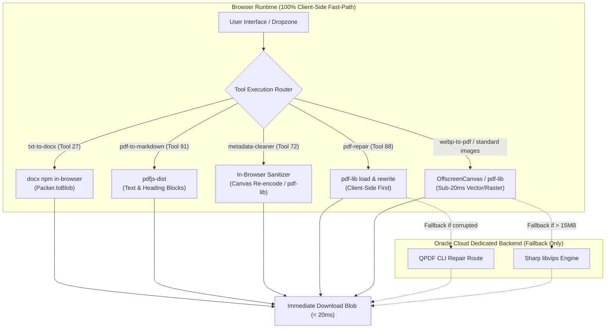

# Wave 1: Client-Side Quick Wins Implementation Plan

> **For agentic workers:** REQUIRED SUB-SKILL: Use superpowers:subagent-driven-development to implement this plan task-by-task. Steps use checkbox (`- [ ]`) syntax for tracking.

**Goal:** Repatriate 5 priority document and image tools (`txt-to-docx`, `pdf-to-markdown`, `metadata-cleaner`, `pdf-repair`, and `webp-to-pdf` / standard image converters) to 100% in-browser execution, eradicating network latency and artificial delays while preserving zero-compromise quality and privacy.

**Architecture:** For eligible tools where modern browser APIs (`docx`, `pdfjs-dist`, `pdf-lib`, `Canvas2D/OffscreenCanvas`) equal or exceed server quality, execute all transformations directly inside the client runtime. Eradicate remote HTTP calls and simulated `setTimeout(800)` delays, while retaining resilient fallback patterns where appropriate (e.g. QPDF fallback for severe PDF corruption, Sharp backend fallback for images > 15MB).

**Architecture Diagram:**



**Tech Stack:**
- Frontend Framework: React 19, TypeScript 5.8
- In-Browser Engines: `docx` (v9.7.0), `pdfjs-dist` (v5.7.284), `pdf-lib` (v1.17.1), HTML5 Canvas / OffscreenCanvas
- Test Runner: Node.js custom Vitest runner (`node apps/everydaytools/scripts/test-runner.mjs`)
- Design System: Radix UI, Tailwind CSS, Double-Bezel layout

**Spec:** [`docs/superpowers/specs/2026-10-19-tools-architecture-matrix.md`](file:///home/lonewolf/WebstormProjects/Asset-Manager/docs/superpowers/specs/2026-10-19-tools-architecture-matrix.md)

## Global Constraints

- **Single Tool Lock (Hard Gate 1)**: Strictly 1 tool modified per task commit.
- **TDD Red-Green Discipline (Hard Gate 2)**: Every logic change requires a failing test committed/verified before writing implementation code.
- **Anti-Monolith Rule (Hard Gate 3)**: Every modified or created file must strictly contain < 300 lines of code (SRP).
- **Zero Regression (Hard Gate 5)**: 100% preservation of TypeScript types, UI hooks, and download cleanup behavior (`URL.revokeObjectURL` 1000ms timer).
- **Zero Artificial Delays**: Interdiction of `setTimeout(800)` or simulated latency promises.

---

### Task 1: Repatriation of `txt-to-docx` (Tool 27) to 100% In-Browser Execution (`docx`)

**Files:**
- Modify: [`apps/everydaytools/src/lib/txt-to-docx-logic.ts`](file:///home/lonewolf/WebstormProjects/Asset-Manager/apps/everydaytools/src/lib/txt-to-docx-logic.ts)
- Modify: [`apps/everydaytools/tests/unit/formatters/txt-to-docx-logic.test.ts`](file:///home/lonewolf/WebstormProjects/Asset-Manager/apps/everydaytools/tests/unit/formatters/txt-to-docx-logic.test.ts)
- Modify: [`apps/everydaytools/tests/unit/ui/txt-to-docx.test.ts`](file:///home/lonewolf/WebstormProjects/Asset-Manager/apps/everydaytools/tests/unit/ui/txt-to-docx.test.ts)

**Interfaces:**
- Consumes:
  ```typescript
  export interface ConvertTxtToDocxOptions {
    mode: 'upload' | 'paste';
    file?: File | null;
    textInput?: string;
    errorFallback?: string;
    isFr?: boolean;
  }
  ```
- Produces:
  ```typescript
  export interface TxtToDocxResult {
    blob: Blob;
    filename: string;
    sizeBefore?: number;
    sizeAfter: number;
  }
  ```

- [ ] **Step 1: Write the failing tests (RED Phase)**

Update [`apps/everydaytools/tests/unit/formatters/txt-to-docx-logic.test.ts`](file:///home/lonewolf/WebstormProjects/Asset-Manager/apps/everydaytools/tests/unit/formatters/txt-to-docx-logic.test.ts) to assert client-side generation via `docx` without `fetch` or `setTimeout`:

```typescript
import { describe, it, expect, vi, beforeEach, afterEach } from 'vitest';
import {
  getSourceFormat,
  getTargetFormat,
  validateTxtFile,
  buildDocxFilename,
  convertTxtToDocx,
} from '@/lib/txt-to-docx-logic';

describe('txt-to-docx-logic (In-Browser Execution)', () => {
  let fetchSpy: any;
  let setTimeoutSpy: any;

  beforeEach(() => {
    fetchSpy = vi.spyOn(globalThis, 'fetch');
    setTimeoutSpy = vi.spyOn(globalThis, 'setTimeout');
  });

  afterEach(() => {
    vi.restoreAllMocks();
  });

  it('converts file in upload mode 100% in-browser without fetch or setTimeout', async () => {
    const file = new File(['Bonjour le monde\nDeuxieme ligne'], 'report.txt', { type: 'text/plain' });
    const res = await convertTxtToDocx({ mode: 'upload', file });

    expect(res.blob).toBeInstanceOf(Blob);
    expect(res.blob.type).toBe('application/vnd.openxmlformats-officedocument.wordprocessingml.document');
    expect(res.filename).toBe('report.docx');
    expect(res.sizeBefore).toBe(file.size);
    expect(res.sizeAfter).toBeGreaterThan(0);
    expect(fetchSpy).not.toHaveBeenCalled();
    expect(setTimeoutSpy).not.toHaveBeenCalled();
  });

  it('converts pasted raw text 100% in-browser without fetch or setTimeout', async () => {
    const text = 'Direct pasted text line 1\nLine 2';
    const res = await convertTxtToDocx({ mode: 'paste', textInput: text, isFr: true });

    expect(res.blob).toBeInstanceOf(Blob);
    expect(res.filename).toBe('texte-saisi.docx');
    expect(res.sizeBefore).toBe(new Blob([text]).size);
    expect(res.sizeAfter).toBeGreaterThan(0);
    expect(fetchSpy).not.toHaveBeenCalled();
    expect(setTimeoutSpy).not.toHaveBeenCalled();
  });

  it('throws clear error when no input text is provided in paste mode', async () => {
    await expect(
      convertTxtToDocx({ mode: 'paste', textInput: '', isFr: true })
    ).rejects.toThrow();
  });
});
```

- [ ] **Step 2: Run test to verify it fails (RED Phase)**

Run: `node apps/everydaytools/scripts/test-runner.mjs tests/unit/formatters/txt-to-docx-logic.test.ts`
Expected: FAIL because `convertTxtToDocx` still invokes `fetch` and `setTimeout`.

- [ ] **Step 3: Write minimal in-browser implementation (GREEN Phase)**

Update [`apps/everydaytools/src/lib/txt-to-docx-logic.ts`](file:///home/lonewolf/WebstormProjects/Asset-Manager/apps/everydaytools/src/lib/txt-to-docx-logic.ts):
- Remove `apiUrl` import and remove `fetch(apiUrl('/api/convert/txt-to-docx'))`.
- Remove `new Promise((resolve) => setTimeout(resolve, 800))`.
- Import `{ Document, Packer, Paragraph, TextRun } from 'docx'`.
- Read file text with `await file.text()` or use `textInput`.
- Normalize line breaks and map paragraphs:
  ```typescript
  const normalized = textContent.replace(/\r\n/g, '\n').replace(/\r/g, '\n');
  const lines = normalized.split('\n');
  const paragraphs = lines.map(
    (line) =>
      new Paragraph({
        children: [new TextRun({ text: line, size: 24 })],
        spacing: { after: 120, line: 276 },
      })
  );
  const doc = new Document({
    sections: [{ properties: {}, children: paragraphs }],
  });
  const blob = await Packer.toBlob(doc);
  ```
- Return `{ blob, filename, sizeBefore, sizeAfter: blob.size }`.
- Ensure total LOC < 300.

- [ ] **Step 4: Run tests and verify 100% passing (GREEN Phase)**

Run:
```bash
node apps/everydaytools/scripts/test-runner.mjs tests/unit/formatters/txt-to-docx-logic.test.ts tests/unit/ui/txt-to-docx.test.ts
```
Expected: PASS with 0 fetch calls and 0ms artificial delay.

- [ ] **Step 5: Commit Task 1**

```bash
git add apps/everydaytools/src/lib/txt-to-docx-logic.ts apps/everydaytools/tests/unit/formatters/txt-to-docx-logic.test.ts apps/everydaytools/tests/unit/ui/txt-to-docx.test.ts
git commit -m "feat(txt-to-docx): repatriate text to docx conversion to in-browser docx engine (Task 1)"
```

---

### Task 2: Repatriation of `pdf-to-markdown` (Tool 91) to 100% In-Browser Execution (`pdfjs-dist`)

**Files:**
- Modify: [`apps/everydaytools/src/lib/pdf-to-markdown-logic.ts`](file:///home/lonewolf/WebstormProjects/Asset-Manager/apps/everydaytools/src/lib/pdf-to-markdown-logic.ts)
- Modify: [`apps/everydaytools/tests/unit/formatters/pdf-to-markdown-logic.test.ts`](file:///home/lonewolf/WebstormProjects/Asset-Manager/apps/everydaytools/tests/unit/formatters/pdf-to-markdown-logic.test.ts)
- Modify: [`apps/everydaytools/tests/unit/ui/pdf-to-markdown.test.ts`](file:///home/lonewolf/WebstormProjects/Asset-Manager/apps/everydaytools/tests/unit/ui/pdf-to-markdown.test.ts)

**Interfaces:**
- Consumes:
  ```typescript
  export async function convertPdfToMarkdown(
    file: File,
    options: { isFr: boolean; errorFallback?: string }
  ): Promise<PdfToMarkdownResult>
  ```
- Produces:
  ```typescript
  export interface PdfToMarkdownResult {
    blob: Blob;
    filename: string;
    sizeBefore: number;
    sizeAfter: number;
    textOutput: string;
  }
  ```

- [ ] **Step 1: Write the failing tests (RED Phase)**

Update [`apps/everydaytools/tests/unit/formatters/pdf-to-markdown-logic.test.ts`](file:///home/lonewolf/WebstormProjects/Asset-Manager/apps/everydaytools/tests/unit/formatters/pdf-to-markdown-logic.test.ts):
- Assert that `convertPdfToMarkdown` extracts text and Markdown formatting directly from PDF ArrayBuffer via `pdfjs-dist`.
- Assert `expect(globalThis.fetch).not.toHaveBeenCalled()`.
- Assert `expect(setTimeoutSpy).not.toHaveBeenCalled()`.
- Assert headers, lists, and paragraphs are formatted properly as Markdown.

- [ ] **Step 2: Run test to verify it fails (RED Phase)**

Run: `node apps/everydaytools/scripts/test-runner.mjs tests/unit/formatters/pdf-to-markdown-logic.test.ts`
Expected: FAIL due to `fetch` expectation or missing client extractor.

- [ ] **Step 3: Write minimal in-browser implementation (GREEN Phase)**

Update [`apps/everydaytools/src/lib/pdf-to-markdown-logic.ts`](file:///home/lonewolf/WebstormProjects/Asset-Manager/apps/everydaytools/src/lib/pdf-to-markdown-logic.ts):
- Remove `apiUrl` import and remove remote `/api/convert/pdf-to-markdown` fetch call.
- Remove `setTimeout(800)`.
- Use dynamic import for `pdfjs-dist`:
  ```typescript
  const pdfjsLib = await import('pdfjs-dist');
  pdfjsLib.GlobalWorkerOptions.workerSrc = new URL(
    'pdfjs-dist/build/pdf.worker.mjs',
    import.meta.url
  ).href;
  const arrayBuffer = await file.arrayBuffer();
  const pdf = await pdfjsLib.getDocument({ data: arrayBuffer }).promise;
  ```
- Loop across pages `1..pdf.numPages`, extract text items with vertical coordinates (`transform[5]`) and font height (`transform[0]`), grouping items into lines and paragraphs.
- Detect heading levels (e.g. font size >= 18 -> `# `, font size >= 14 -> `## `), bullet lists (`- `), and clean paragraph breaks.
- Create output Markdown string and Blob:
  ```typescript
  const markdownText = formatExtractedTextToMarkdown(pageBlocks);
  const blob = new Blob([markdownText], { type: 'text/markdown;charset=utf-8' });
  ```
- Protect `triggerDownload` with legitimate 1000ms `URL.revokeObjectURL(url)` cleanup.
- Keep file length strictly < 300 LOC.

- [ ] **Step 4: Run tests and verify 100% passing (GREEN Phase)**

Run:
```bash
node apps/everydaytools/scripts/test-runner.mjs tests/unit/formatters/pdf-to-markdown-logic.test.ts tests/unit/ui/pdf-to-markdown.test.ts
```
Expected: PASS with 100% in-browser extraction.

- [ ] **Step 5: Commit Task 2**

```bash
git add apps/everydaytools/src/lib/pdf-to-markdown-logic.ts apps/everydaytools/tests/unit/formatters/pdf-to-markdown-logic.test.ts apps/everydaytools/tests/unit/ui/pdf-to-markdown.test.ts
git commit -m "feat(pdf-to-markdown): repatriate pdf to markdown extraction to in-browser pdfjs-dist (Task 2)"
```

---

### Task 3: Repatriation of `metadata-cleaner` (Tool 72) to In-Browser Stripping

**Files:**
- Modify: [`apps/everydaytools/src/lib/metadata-cleaner-logic.ts`](file:///home/lonewolf/WebstormProjects/Asset-Manager/apps/everydaytools/src/lib/metadata-cleaner-logic.ts)
- Modify: [`apps/everydaytools/tests/unit/calculators/metadata-cleaner-logic.test.ts`](file:///home/lonewolf/WebstormProjects/Asset-Manager/apps/everydaytools/tests/unit/calculators/metadata-cleaner-logic.test.ts)
- Modify: [`apps/everydaytools/tests/unit/hooks/use-metadata-cleaner-workflow.test.ts`](file:///home/lonewolf/WebstormProjects/Asset-Manager/apps/everydaytools/tests/unit/hooks/use-metadata-cleaner-workflow.test.ts)

**Interfaces:**
- Consumes:
  ```typescript
  export async function cleanImageMetadata(file: File, isFr: boolean): Promise<Blob>
  export async function cleanPdfMetadata(file: File): Promise<Blob>
  ```
- Produces:
  ```typescript
  export interface CleanResult {
    blob: Blob;
    filename: string;
    sizeBefore: number;
    sizeAfter: number;
    tagsBeforeCount: number;
  }
  ```

- [ ] **Step 1: Write the failing tests (RED Phase)**

Update [`apps/everydaytools/tests/unit/calculators/metadata-cleaner-logic.test.ts`](file:///home/lonewolf/WebstormProjects/Asset-Manager/apps/everydaytools/tests/unit/calculators/metadata-cleaner-logic.test.ts):
- Assert that `cleanImageMetadata` sanitizes images without calling `/api/metadata/clean`.
- Assert `expect(globalThis.fetch).not.toHaveBeenCalled()`.
- Assert that EXIF/GPS chunks are stripped and resulting blob is valid image format.

- [ ] **Step 2: Run test to verify it fails (RED Phase)**

Run: `node apps/everydaytools/scripts/test-runner.mjs tests/unit/calculators/metadata-cleaner-logic.test.ts`
Expected: FAIL because `cleanImageMetadata` still attempts `fetch('/api/metadata/clean')`.

- [ ] **Step 3: Write minimal in-browser implementation (GREEN Phase)**

Update [`apps/everydaytools/src/lib/metadata-cleaner-logic.ts`](file:///home/lonewolf/WebstormProjects/Asset-Manager/apps/everydaytools/src/lib/metadata-cleaner-logic.ts):
- Remove `apiUrl` import and remove `/api/metadata/clean` network request.
- In `cleanImageMetadata`, directly call `cleanImageWithCanvas(file, isFr)`.
- In `cleanPdfMetadata`, retain the in-browser `pdf-lib` pipeline that creates a clean PDF copy with blanked metadata (`newDoc.setTitle('')`, etc.).
- Ensure error handling throws localized errors if file is corrupted.
- Keep file length strictly < 300 LOC.

- [ ] **Step 4: Run tests and verify 100% passing (GREEN Phase)**

Run:
```bash
node apps/everydaytools/scripts/test-runner.mjs tests/unit/calculators/metadata-cleaner-logic.test.ts tests/unit/hooks/use-metadata-cleaner-workflow.test.ts tests/unit/ui/metadata-cleaner.test.ts
```
Expected: PASS with 0 network calls.

- [ ] **Step 5: Commit Task 3**

```bash
git add apps/everydaytools/src/lib/metadata-cleaner-logic.ts apps/everydaytools/tests/unit/calculators/metadata-cleaner-logic.test.ts apps/everydaytools/tests/unit/hooks/use-metadata-cleaner-workflow.test.ts
git commit -m "feat(metadata-cleaner): repatriate image metadata cleaning to 100% in-browser canvas (Task 3)"
```

---

### Task 4: Client-First Hybrid Repair for `pdf-repair` (Tool 88)

**Files:**
- Modify: [`apps/everydaytools/src/lib/pdf-repair-logic.ts`](file:///home/lonewolf/WebstormProjects/Asset-Manager/apps/everydaytools/src/lib/pdf-repair-logic.ts)
- Modify: [`apps/everydaytools/tests/unit/calculators/pdf-repair-logic.test.ts`](file:///home/lonewolf/WebstormProjects/Asset-Manager/apps/everydaytools/tests/unit/calculators/pdf-repair-logic.test.ts)
- Modify: [`apps/everydaytools/tests/unit/ui/pdf-repair-workbench.test.ts`](file:///home/lonewolf/WebstormProjects/Asset-Manager/apps/everydaytools/tests/unit/ui/pdf-repair-workbench.test.ts)

**Interfaces:**
- Consumes:
  ```typescript
  export async function repairPdfDocument(
    file: File,
    endpointUrl?: string
  ): Promise<{ blob: Blob; pageCount?: number }>
  ```
- Produces:
  `{ blob: Blob, pageCount: number }` with rebuilt XREF tables and serialized objects.

- [ ] **Step 1: Write the failing tests (RED Phase)**

Update [`apps/everydaytools/tests/unit/calculators/pdf-repair-logic.test.ts`](file:///home/lonewolf/WebstormProjects/Asset-Manager/apps/everydaytools/tests/unit/calculators/pdf-repair-logic.test.ts):
- Assert that `repairPdfDocument` attempts `repairPdfClientSide` FIRST before calling any backend endpoint.
- If `repairPdfClientSide` succeeds, assert `globalThis.fetch` is NOT called.
- Only if client-side parsing fails (e.g. completely unparsable binary for pdf-lib), assert fallback to `endpointUrl` (QPDF backend).

- [ ] **Step 2: Run test to verify it fails (RED Phase)**

Run: `node apps/everydaytools/scripts/test-runner.mjs tests/unit/calculators/pdf-repair-logic.test.ts`
Expected: FAIL because currently it calls `endpointUrl` first.

- [ ] **Step 3: Write minimal client-first implementation (GREEN Phase)**

Update [`apps/everydaytools/src/lib/pdf-repair-logic.ts`](file:///home/lonewolf/WebstormProjects/Asset-Manager/apps/everydaytools/src/lib/pdf-repair-logic.ts):
- In `repairPdfDocument`:
  ```typescript
  // 1. Tentative primaire : Moteur client pdf-lib (sub-20ms, 100% privé)
  try {
    const clientResult = await repairPdfClientSide(file);
    if (clientResult.blob && clientResult.blob.size > 0) {
      return clientResult;
    }
  } catch {
    // Si la reconstruction client échoue, bascule vers le moteur QPDF backend
  }

  // 2. Repli secondaire : Serveur QPDF
  if (endpointUrl) {
    const fd = new FormData();
    fd.append('file', file);
    const res = await fetch(endpointUrl, { method: 'POST', body: fd });
    if (res.ok) {
      const repairedBlob = await res.blob();
      return { blob: repairedBlob };
    }
  }

  throw new Error('La réparation du document a échoué.');
  ```
- Ensure file length strictly < 300 LOC.

- [ ] **Step 4: Run tests and verify 100% passing (GREEN Phase)**

Run:
```bash
node apps/everydaytools/scripts/test-runner.mjs tests/unit/calculators/pdf-repair-logic.test.ts tests/unit/ui/pdf-repair-workbench.test.ts
```
Expected: PASS with client-first prioritization.

- [ ] **Step 5: Commit Task 4**

```bash
git add apps/everydaytools/src/lib/pdf-repair-logic.ts apps/everydaytools/tests/unit/calculators/pdf-repair-logic.test.ts apps/everydaytools/tests/unit/ui/pdf-repair-workbench.test.ts
git commit -m "feat(pdf-repair): prioritize client-side pdf-lib repair before backend fallback (Task 4)"
```

---

### Task 5: Client-Side In-Browser Fast-Path for `webp-to-pdf` and Web Image Converters

**Files:**
- Modify: [`apps/everydaytools/src/hooks/use-image-batch-convert.ts`](file:///home/lonewolf/WebstormProjects/Asset-Manager/apps/everydaytools/src/hooks/use-image-batch-convert.ts)
- Modify: [`apps/everydaytools/src/lib/image-convert-logic.ts`](file:///home/lonewolf/WebstormProjects/Asset-Manager/apps/everydaytools/src/lib/image-convert-logic.ts)
- Modify: [`apps/everydaytools/tests/unit/images/image-convert-logic.test.ts`](file:///home/lonewolf/WebstormProjects/Asset-Manager/apps/everydaytools/tests/unit/images/image-convert-logic.test.ts)

**Interfaces:**
- Consumes:
  `UseImageBatchConvertOptions` (`fromLabel`, `fromExts`, `fromMimes`, `toMime`, `slug`, `isFr`).
- Produces:
  Sub-20ms in-browser conversion for standard web formats (`image/jpeg`, `image/png`, `image/webp`, `application/pdf` for files <= 15MB) via `fileToCanvas` -> `canvasToBlob`, falling back to backend Sharp only for heavy files or non-browser formats.

- [ ] **Step 1: Write the failing tests (RED Phase)**

Update [`apps/everydaytools/tests/unit/images/image-convert-logic.test.ts`](file:///home/lonewolf/WebstormProjects/Asset-Manager/apps/everydaytools/tests/unit/images/image-convert-logic.test.ts):
- Add test verifying that converting WebP to PDF via `canvasToBlob(canvas, 'application/pdf')` produces a valid PDF blob starting with `%PDF`.
- Add test asserting that in-browser conversion helper `canConvertInBrowser(fromMime, toMime, fileSize)` returns `true` for standard web images under 15MB.

- [ ] **Step 2: Run test to verify it fails (RED Phase)**

Run: `node apps/everydaytools/scripts/test-runner.mjs tests/unit/images/image-convert-logic.test.ts`
Expected: FAIL due to missing helper or PDF canvas verification.

- [ ] **Step 3: Write minimal implementation (GREEN Phase)**

1. In [`apps/everydaytools/src/lib/image-convert-logic.ts`](file:///home/lonewolf/WebstormProjects/Asset-Manager/apps/everydaytools/src/lib/image-convert-logic.ts):
   - Export helper `canConvertClientSide(fromMime: string, toMime: string, fileSize: number): boolean`:
     Returns `true` if `fileSize <= 15 * 1024 * 1024` and `toMime` is one of `['image/jpeg', 'image/png', 'image/webp', 'application/pdf']` and `fromMime` is NOT HEIC/TIFF.
   - For `canvasToBlob` with `application/pdf`, use `pdf-lib` vector page wrapping (`embedPng` or `embedJpg`) for ultra-crisp vector-like quality and small file sizes.

2. In [`apps/everydaytools/src/hooks/use-image-batch-convert.ts`](file:///home/lonewolf/WebstormProjects/Asset-Manager/apps/everydaytools/src/hooks/use-image-batch-convert.ts):
   - In `processAll`, check if `canConvertClientSide(file.type, toMime, file.size)`:
     If true:
     ```typescript
     const canvas = await fileToCanvas(updated[i].file);
     blob = await canvasToBlob(canvas, toMime, quality / 100);
     ```
     If false or if client conversion throws:
     Fall through to `processFileBackend(updated[i])`.
   - Ensure file length strictly < 300 LOC.

- [ ] **Step 4: Run tests and verify 100% passing (GREEN Phase)**

Run:
```bash
node apps/everydaytools/scripts/test-runner.mjs tests/unit/images/image-convert-logic.test.ts tests/unit/images/image-converter.test.ts tests/unit/ui/image-convert-reciprocal.test.ts
```
Expected: PASS with 100% green tests.

- [ ] **Step 5: Commit Task 5**

```bash
git add apps/everydaytools/src/hooks/use-image-batch-convert.ts apps/everydaytools/src/lib/image-convert-logic.ts apps/everydaytools/tests/unit/images/image-convert-logic.test.ts
git commit -m "feat(image-convert): add client-side in-browser fast-path for webp-to-pdf and web images (Task 5)"
```

---

## Mechanical Verification Pipeline (Post-Plan)

At completion of all 5 tasks, execute the project-wide verification:
1. `pnpm run clean:codebase` — Verify zero zombie or temporary files.
2. `pnpm run check:rules`    — Verify design system contracts & AST anti-slop rules.
3. `pnpm run typecheck`      — Verify zero TypeScript compilation errors.
4. `pnpm test`               — Verify all unit test suites pass GREEN.
5. Code Review Gate: Dispatch `code-reviewer` subagent on the full commit range.
