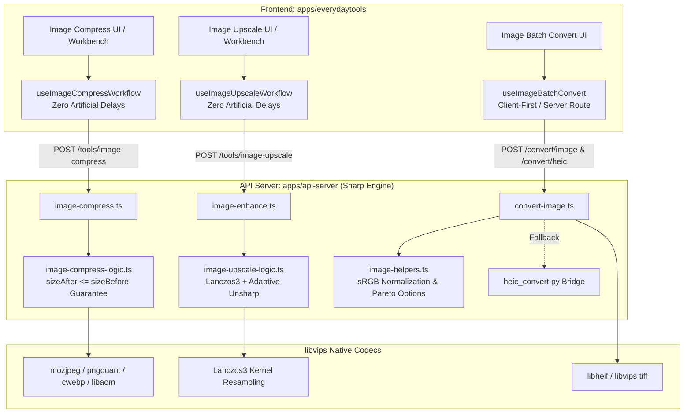

# Wave 2: Pipeline Image Haute Fidélité Sharp (Backend & Workflows) Implementation Plan

> **For agentic workers:** REQUIRED SUB-SKILL: Use superpowers:subagent-driven-development to implement this plan task-by-task. Steps use checkbox (`- [ ]`) syntax for tracking.

**Goal:** Implement Wave 2 of the EverydayTools Hub technical excellence roadmap: build the high-fidelity Sharp image backend pipeline and eradicate artificial delays on frontend image workflows. Specifically, deliver mathematical size reduction guarantees (`sizeAfter <= sizeBefore`) on `image-compress`, high-fidelity modern codec support (AVIF, HEIC, TIFF, WebP) with sRGB color normalization and alpha channel preservation, and 2x/4x Lanczos3 adaptive unsharp upscaling on `image-upscale`.

**Architecture:**
- **Backend Sharp Core (`apps/api-server`):**
  - Modular image logic engines (`image-compress-logic.ts`, `image-upscale-logic.ts`, `convert-image.ts`, `image-helpers.ts`) utilizing `sharp` (libvips) with compiled native encoders (`libheif`, `libaom`, `libmozjpeg`, `libpngquant`).
  - Color space management: sRGB profile preservation via `createColorManagedPipeline` to prevent color degradation on Display P3 Apple photos.
  - Strict mathematical guarantee on `image-compress`: if compressed size exceeds input size, fallback to metadata-stripped original with `sizeAfter <= sizeBefore`.
  - Python daemon/bridge fallback for exotic HEIC inputs if native libheif encounters decoding limits.
- **Frontend Workflows (`apps/everydaytools`):**
  - Eradicate all artificial delays (`setTimeout(2400)`) in `use-image-compress-workflow.ts` and `use-image-upscale-workflow.ts`.
  - Provide instantaneous reactivity with real network upload/download telemetry.
  - Client-side in-browser canvas fallbacks for resilience when server connectivity is interrupted.

**Architecture Diagram:**



**Tech Stack:**
- Node.js 22 LTS, TypeScript 5.8
- `sharp` 0.33+ (libvips, mozjpeg, pngquant, libheif, libaom, cwebp)
- `pdf-lib` (vector image embedding)
- React 19, Tailwind CSS v4, Lucide React
- Node.js native test runner (`node:test`, `node:assert/strict`)

**Spec:** [`docs/superpowers/specs/2026-10-19-tools-architecture-matrix.md`](file:///home/lonewolf/WebstormProjects/Asset-Manager/docs/superpowers/specs/2026-10-19-tools-architecture-matrix.md)

## Global Constraints

- **Single Tool Lock (Hard Gate 1):** Strictly 1 tool modified per task commit.
- **TDD Red-Green Discipline (Hard Gate 2):** Every logic change requires a failing test before implementation.
- **Anti-Monolith Rule (Hard Gate 3):** Every modified or created file must strictly contain < 300 lines of code (SRP).
- **Zero Zombie / Sanitation (Hard Gate 4):** Zero leftover temporary files, zero unused imports.
- **Zero Regression (Hard Gate 5):** 100% preservation of TypeScript types, routes, and existing test suites.
- **Zero Artificial Delays:** Absolute ban on `setTimeout(2400)` or simulated latency promises.
- **Awwwards Honesty Gate (Hard Gate 6):** Fluid UX without visual flashes, responsive state transitions.

---

### Task 1: `image-compress` (Tool 41) Logic Modularization, Size Guarantee & Zero Delay

**Files:**
- Create: `apps/api-server/src/routes/images/image-compress-logic.ts`
- Modify: `apps/api-server/src/routes/images/image-compress.ts`
- Modify: `apps/api-server/src/routes/images/image-compress.test.ts`
- Modify: `apps/everydaytools/src/hooks/use-image-compress-workflow.ts`
- Create: `apps/everydaytools/tests/unit/hooks/use-image-compress-workflow.test.ts`

**Interfaces:**
- Consumes: Raw image buffer (`Buffer`) with mime type, target quality / targetKB, resize options.
- Produces:
  ```typescript
  export interface CompressImageResult {
    buffer: Buffer;
    mime: string;
    ext: string;
    originalSize: number;
    compressedSize: number;
    gain: number;
  }
  export async function compressImageBuffer(
    input: Buffer,
    mime: string,
    options: {
      quality?: number;
      targetKB?: number;
      resizeMode?: 'none' | 'percent' | 'dimensions';
      resizePct?: number;
      resizeW?: number;
      resizeH?: number;
      isGraphic?: boolean;
    }
  ): Promise<CompressImageResult>
  ```
- Strict size guarantee: `compressedSize <= originalSize`. If compression generates a larger buffer (e.g. attempting to compress an already heavily compressed JPEG/PNG), return the metadata-stripped buffer or original, ensuring `gain >= 0`.
- Eradicates artificial delay: Remove `new Promise((resolve) => setTimeout(resolve, 2400))` from `use-image-compress-workflow.ts` and replace the simulated 2400ms duration countdown with real loading telemetry.

- [ ] **Step 1: Write the failing tests for `image-compress-logic` and size guarantee**
  - In `apps/api-server/src/routes/images/image-compress.test.ts`, add tests for `compressImageBuffer`:
    - Test compressing a pre-compressed JPEG at quality 95: assert `result.compressedSize <= result.originalSize`.
    - Test compressing PNG, WebP, AVIF: assert `result.gain >= 0`.
    - Test `targetKB` constraint: assert output respects target byte limit when possible.
  - In `apps/everydaytools/tests/unit/hooks/use-image-compress-workflow.test.ts`:
    - Test that `handleCompress` does NOT call `setTimeout` with artificial delays (spy on `setTimeout`).
    - Test workflow state transitions (`isProcessing`, `result`, `error`).
  - Run tests to confirm RED:
    `node apps/api-server/scripts/test-runner.mjs src/routes/images/image-compress.test.ts`
    `node apps/everydaytools/scripts/test-runner.mjs tests/unit/hooks/use-image-compress-workflow.test.ts`

- [ ] **Step 2: Implement `image-compress-logic.ts` with strict size guarantee**
  - Extract compression logic from `apps/api-server/src/routes/images/image-compress.ts` into `apps/api-server/src/routes/images/image-compress-logic.ts` (< 250 LOC).
  - Implement `compressImageBuffer`:
    - Apply Lanczos3 resize if requested.
    - Run `compressAtQuality` or `compressToTargetBytes`.
    - Check output size vs input size. If `output.length > input.length`:
      - Fall back to strip metadata: `await createColorManagedPipeline(input).toBuffer()`.
      - If even that is larger, return original `input` with `gain = 0`.
    - Return `CompressImageResult`.
  - Refactor `apps/api-server/src/routes/images/image-compress.ts`:
    - Delegate `POST /tools/image-compress` to `compressImageBuffer`.
    - Set headers: `X-Original-Size`, `X-Compressed-Size`, `X-Compression-Gain`.
    - Keep total LOC strictly < 300 LOC.

- [ ] **Step 3: Eradicate artificial delay in `use-image-compress-workflow.ts`**
  - In `apps/everydaytools/src/hooks/use-image-compress-workflow.ts`:
    - Remove `new Promise((resolve) => setTimeout(resolve, 2400))`.
    - Remove the simulated 2400ms countdown in `useEffect`; replace with dynamic processing telemetry or remove artificial timer.
    - Set `result` immediately when `fetch` resolves.
    - Keep total LOC strictly < 300 LOC.

- [ ] **Step 4: Run unit tests and verify GREEN**
  - Run:
    `node apps/api-server/scripts/test-runner.mjs src/routes/images/image-compress.test.ts`
    `node apps/everydaytools/scripts/test-runner.mjs tests/unit/hooks/use-image-compress-workflow.test.ts tests/unit/calculators/image-compress-logic.test.ts`
    `pnpm --filter @workspace/api-server test`
    `pnpm --filter @workspace/everydaytools exec tsc --noEmit`
    `pnpm run check:rules`
  - Confirm all tests pass 100%.

- [ ] **Step 5: Commit Task 1**
  - Stage ONLY files for Task 1:
    `git add apps/api-server/src/routes/images/image-compress-logic.ts apps/api-server/src/routes/images/image-compress.ts apps/api-server/src/routes/images/image-compress.test.ts apps/everydaytools/src/hooks/use-image-compress-workflow.ts apps/everydaytools/tests/unit/hooks/use-image-compress-workflow.test.ts`
  - Commit message: `feat(image-compress): add size reduction guarantee, modularize logic, and eradicate artificial delay (Task 1)`

---

### Task 2: Heavy & Modern Codecs Sharp Pipeline (AVIF, HEIC, TIFF, WebP)

**Files:**
- Modify: `apps/api-server/src/routes/convert/convert-image.ts`
- Modify: `apps/api-server/src/routes/convert/convert-image.test.ts`
- Modify: `apps/api-server/src/routes/images/image-helpers.ts`

**Interfaces:**
- Consumes:
  ```typescript
  export interface ConvertImageOptions {
    format: string;
    quality?: number;
    width?: number;
    height?: number;
    isGeometric?: boolean;
    preserveAlpha?: boolean;
  }
  export async function convertImageBuffer(
    inputBuffer: Buffer,
    options: ConvertImageOptions
  ): Promise<{ buffer: Buffer; mime: string; ext: string }>
  ```
- Requirements:
  - Alpha transparency preservation: For transparent inputs converting to PNG, WebP, or AVIF, do NOT flatten to white background. Only flatten to background when converting to JPEG or 3-channel destination.
  - Color management: Ensure `createColorManagedPipeline` applies `.rotate().withIccProfile("srgb")` to prevent color degradation.
  - HEIC route `/convert/heic`: Robust handling of HEIC to JPEG, PNG, WebP, and PDF with automatic fallback to Python bridge `heic_convert.py` on libheif unsupported formats.
  - TIFF multi-page/deep-color: Deflate compression, correct channel extraction.
  - All files strictly < 300 LOC (Anti-Monolith).

- [ ] **Step 1: Write the failing tests for transparency preservation and codec conversions**
  - In `apps/api-server/src/routes/convert/convert-image.test.ts`:
    - Test transparent PNG to WebP: assert alpha channel is preserved (`hasAlpha: true`).
    - Test transparent PNG to AVIF: assert alpha channel is preserved (`hasAlpha: true`).
    - Test transparent PNG to JPEG: assert background is flattened to white (`hasAlpha: false`).
    - Test TIFF conversion with deflation and sRGB color profile.
    - Test HEIC conversion error handling and temporary workspace cleanup.
  - Run test to confirm failing RED:
    `node apps/api-server/scripts/test-runner.mjs src/routes/convert/convert-image.test.ts`

- [ ] **Step 2: Implement transparency preservation and codec enhancements**
  - In `apps/api-server/src/routes/convert/convert-image.ts`:
    - Ensure `pipeline.flatten()` is ONLY applied for formats that do not support alpha (JPEG).
    - Ensure AVIF, WebP, and PNG retain alpha channel while normalizing color to sRGB.
    - Verify `heicViaSharp` and `heicViaPython` error handling and ensure temporary directories in `/tmp/everydaytools/` are always removed in `finally`.
  - In `apps/api-server/src/routes/images/image-helpers.ts`:
    - Ensure `getOptimizedAvifOptions` and `getOptimizedWebpOptions` support alpha quality and proper chroma subsampling.
  - Verify total LOC of `convert-image.ts` and `image-helpers.ts` strictly < 300 LOC.

- [ ] **Step 3: Run unit tests and verify GREEN**
  - Run:
    `node apps/api-server/scripts/test-runner.mjs src/routes/convert/convert-image.test.ts`
    `pnpm --filter @workspace/api-server test`
    `pnpm run check:rules`
  - Confirm all tests pass 100%.

- [ ] **Step 4: Commit Task 2**
  - Stage ONLY files for Task 2:
    `git add apps/api-server/src/routes/convert/convert-image.ts apps/api-server/src/routes/convert/convert-image.test.ts apps/api-server/src/routes/images/image-helpers.ts`
  - Commit message: `feat(convert-image): preserve alpha transparency, harden modern codecs and sRGB color management (Task 2)`

---

### Task 3: `image-upscale` (Tool 85) Precision Pipeline & Zero Delay

**Files:**
- Modify: `apps/api-server/src/routes/images/image-upscale-logic.ts`
- Modify: `apps/api-server/src/routes/images/image-upscale-logic.test.ts`
- Modify: `apps/everydaytools/src/hooks/use-image-upscale-workflow.ts`
- Modify: `apps/everydaytools/tests/unit/images/image-upscale.test.ts`

**Interfaces:**
- Consumes: Image file/buffer with scale factor (2x or 4x), sharpen flag, output format.
- Produces:
  High-resolution upscaled image with Lanczos3 interpolation and non-linear adaptive unsharp mask (`sigma: 0.8, m1: 0.8, m2: 0.3`).
- Constraints:
  - Max dimension clamped to 8000px to prevent server OOM.
  - Zero artificial delay in frontend hook `use-image-upscale-workflow.ts`.
  - Robust in-browser canvas fallback `upscaleCanvasClientSide` if backend is unreachable.
  - Anti-Monolith: All files strictly < 300 LOC.

- [ ] **Step 1: Write failing tests for upscale logic and frontend workflow**
  - In `apps/api-server/src/routes/images/image-upscale-logic.test.ts`:
    - Test upscaling with transparency: PNG retains alpha channel after upscaling.
    - Test clamping at 8000px: extreme input dimensions are scaled proportionally without exceeding 8000px.
    - Test unsharp mask sharpness enhancement.
  - In `apps/everydaytools/tests/unit/images/image-upscale.test.ts`:
    - Assert that `handleUpscale` does NOT call artificial `setTimeout` delays.
    - Test client-side canvas fallback execution when backend returns 500 or network fails.
  - Run test to confirm RED:
    `node apps/api-server/scripts/test-runner.mjs src/routes/images/image-upscale-logic.test.ts`
    `node apps/everydaytools/scripts/test-runner.mjs tests/unit/images/image-upscale.test.ts`

- [ ] **Step 2: Implement precision enhancements and workflow verification**
  - In `apps/api-server/src/routes/images/image-upscale-logic.ts`:
    - Ensure alpha channel is preserved on PNG/WebP upscaling (flatten only for JPEG).
    - Maintain Lanczos3 kernel and adaptive unsharp mask.
    - File stays < 100 LOC.
  - In `apps/everydaytools/src/hooks/use-image-upscale-workflow.ts`:
    - Verify that no artificial delays or simulated timers exist during upscale.
    - Keep file length strictly < 300 LOC (currently 259 LOC).

- [ ] **Step 3: Run unit tests and verify GREEN**
  - Run:
    `node apps/api-server/scripts/test-runner.mjs src/routes/images/image-upscale-logic.test.ts src/routes/images/image-enhance.test.ts`
    `node apps/everydaytools/scripts/test-runner.mjs tests/unit/images/image-upscale.test.ts tests/unit/images/image-upscale-logic.test.ts`
    `pnpm --filter @workspace/api-server test`
    `pnpm --filter @workspace/everydaytools exec tsc --noEmit`
    `pnpm run check:rules`
  - Confirm all tests pass 100%.

- [ ] **Step 4: Commit Task 3**
  - Stage ONLY files for Task 3:
    `git add apps/api-server/src/routes/images/image-upscale-logic.ts apps/api-server/src/routes/images/image-upscale-logic.test.ts apps/everydaytools/src/hooks/use-image-upscale-workflow.ts apps/everydaytools/tests/unit/images/image-upscale.test.ts`
  - Commit message: `feat(image-upscale): enhance Lanczos3 precision, preserve alpha transparency, and verify zero artificial delay (Task 3)`

---

### Task 4: Mechanical Verification & Subagent Review Gate

- [ ] **Step 1: Execute mechanical verification pipeline**
  - `pnpm run clean:codebase` — Verify 0 zombie or temporary files.
  - `pnpm run check:rules` — Verify 0 AST/anti-slop rule violations.
  - `pnpm run typecheck` — Verify 0 TypeScript compiler errors.
  - `pnpm test` — Verify 100% test suites pass GREEN across all workspaces.

- [ ] **Step 2: Delegate independent whole-branch review to `code-reviewer`**
  - Dispatch `code-reviewer` subagent on the full commit range of Wave 2.
  - Address any findings or record rulings in the SDD ledger.

- [ ] **Step 3: Final Integration**
  - Merge feature branch back to `main`.
  - Report final status and metrics to user.
