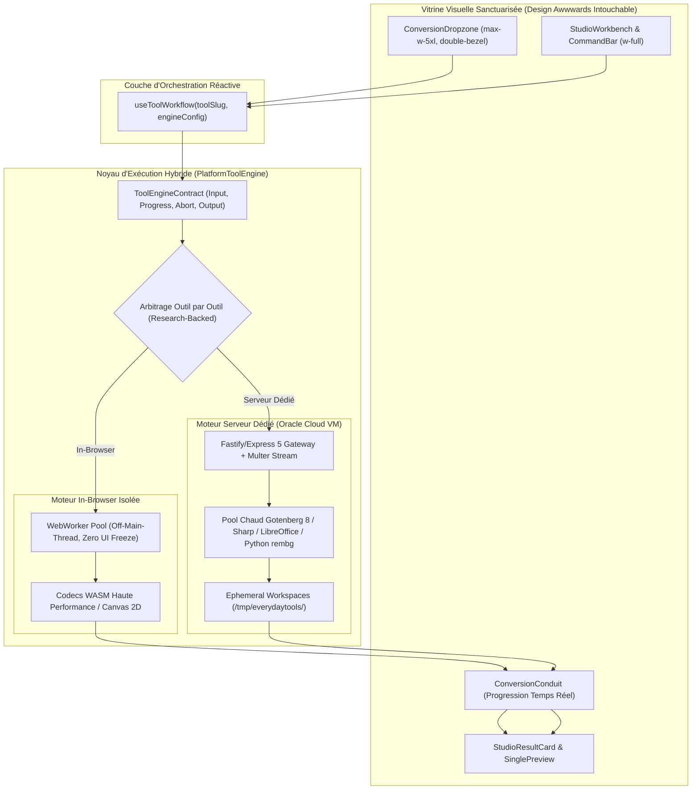
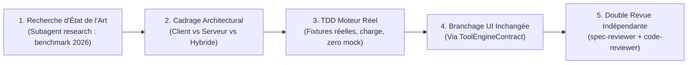

# Architecture Plateforme & Protocole d'Excellence Outil par Outil

> **For agentic workers:** REQUIRED SUB-SKILL: Use superpowers:subagent-driven-development to implement this plan task-by-task. Steps use checkbox (`- [ ]`) syntax for tracking.

**Goal:** Mettre en place l'architecture moteur la plus solide pour la plateforme EverydayTools (WebWorkers isolés, streaming, hook unifié, pool serveur résilient) puis refondre et moderniser chaque outil un par un avec les meilleures librairies mondiales (WASM ou Serveur) via recherche d'état de l'art, **tout en sanctuarisant à 100% le design visuel actuel sans aucune dégradation**.

**Architecture:** Découplage strict entre la vitrine visuelle Awwwards (composants UI immuables : `ConversionDropzone`, `StudioWorkbench`, `StudioCommandBar`) et la couche d'exécution (`PlatformToolEngine`). L'exécution est pilotée par un contrat universel (`ToolEngineContract`) qui gère les WebWorkers en arrière-plan, la progression en temps réel, l'annulation `AbortSignal`, et bascule intelligemment entre Client-Side (WASM/Canvas/Crypto) et Serveur Dédié (Gotenberg/Sharp/LibreOffice/Python).

**Architecture Diagram:**

**Tech Stack:**
- Frontend : React 19, TypeScript strict, Web Workers (Vite `new Worker(new URL(...), { type: 'module' })`), Transferable Streams.
- Backend : Express 5 / Node.js 24, Gotenberg 8, LibreOffice 24.2, Sharp libvips 0.34, Ghostscript 10, QPDF, Python 3.12 (rembg ONNX).
- Recherche d'état de l'art : Sous-agent `research` & Web Search (WASM Rust/C++, benchmarks 2026).
- Tests & Validation : Vitest, Playwright E2E visual regression, TDD RED-GREEN strict.

---

## Global Constraints

1. **SANCTUARISATION VISUELLE STRICTE** : Zéro régression visuelle. L'interface graphique, les couleurs Radix, le double-bezel, les micro-hairlines 1px et les animations sont sanctuarisés.
2. **ZERO UI FREEZE (OFF-MAIN-THREAD)** : Tout calcul client dépassant 16ms doit obligatoirement s'exécuter dans un WebWorker dédié.
3. **RESEARCH-DRIVEN SELECTION** : Tout choix de librairie pour un outil doit être justifié par une recherche d'état de l'art récente (2025-2026) avec benchmark comparatif.
4. **ANTI-MONOLITHE STRICT** : Chaque fichier créé ou modifié doit faire strictement < 300 lignes de code.
5. **SINGLE TOOL LOCK** : On traite un seul outil à la fois jusqu'à certification complète avant de passer au suivant.

---

## Phase 1 : Le Socle d'Architecture Global

### Task 1.1 : Le Contrat Universel d'Outil (`ToolEngineContract`) & Hook Unifié

**Files:**
- Create: `apps/everydaytools/src/engine/tool-contract.ts`
- Create: `apps/everydaytools/src/engine/use-tool-workflow.ts`
- Test: `apps/everydaytools/tests/unit/engine/tool-contract.test.ts`

**Interfaces:**
- `ToolEngineContract<TInput, TOutput>`: interface standardisée avec méthodes `execute(input, options): Promise<TOutput>` et `abort(): void`.
- `useToolWorkflow(options)`: hook réactif connectant n'importe quel moteur aux composants UI existants (`ConversionDropzone`, `ConversionConduit`, `StudioResultCard`).

- [ ] **Step 1: Écrire le test TDD RED pour ToolEngineContract et useToolWorkflow**
- [ ] **Step 2: Vérifier le statut RED du test**
- [ ] **Step 3: Implémenter `tool-contract.ts` et `use-tool-workflow.ts` (< 300 LOC)**
- [ ] **Step 4: Vérifier que le test passe GREEN**
- [ ] **Step 5: Valider et commiter**

---

### Task 1.2 : Le Pipeline WebWorker Client Universel (`WorkerEngineHost`)

**Files:**
- Create: `apps/everydaytools/src/engine/worker-engine-host.ts`
- Create: `apps/everydaytools/src/engine/worker-dispatcher.ts`
- Test: `apps/everydaytools/tests/unit/engine/worker-engine-host.test.ts`

**Interfaces:**
- Offload transparent de calculs lourds (Canvas, parsing, hachage, compression) avec passage de `Transferable ArrayBuffer`.
- Suivi de progression native en pourcentage réel `(current, total) => number` sans estimation factice.

- [ ] **Step 1: Écrire le test TDD RED simulant un calcul lourd avec transfert mémoire et annulation**
- [ ] **Step 2: Vérifier le statut RED**
- [ ] **Step 3: Implémenter le dispatch et l'hôte de WebWorkers**
- [ ] **Step 4: Vérifier le statut GREEN**
- [ ] **Step 5: Valider et commiter**

---

### Task 1.3 : Le Pipeline Serveur Haute Performance & Isolation

**Files:**
- Modify: `apps/api-server/src/lib/libreoffice.ts`
- Create: `apps/api-server/src/lib/process-pool.ts`
- Test: `apps/api-server/src/lib/process-pool.test.ts`

**Interfaces:**
- Pool de processus géré avec limitation de concurrence, timeout dur et éviction automatique `/tmp/everydaytools/<uuid>`.
- Mode streaming HTTP/2 chunked pour les gros uploads (> 50 Mo) évitant l'épuisement de la RAM Node.js.

- [ ] **Step 1: Écrire le test unitaire pour la gestion du pool et de la concurrence**
- [ ] **Step 2: Vérifier le statut RED**
- [ ] **Step 3: Implémenter `process-pool.ts` avec gestion de files d'attente et TTL de nettoyage**
- [ ] **Step 4: Vérifier le statut GREEN**
- [ ] **Step 5: Valider et commiter**

---

## Phase 2 : Le Protocole Outil par Outil (Deep-Dive Cycle)

Pour chaque outil du Hub, l'exécution suit rigoureusement ce protocole à 5 portes :

---

## Phase 3 : Premier Outil Pilote — `pdf-to-word` (#1)

**Problème actuel identifié :**
Actuellement, `pdf-to-word` fait une extraction texte basique via `pdfplumber`/`pdfjs-dist` et tente de reconstruire un fichier `.docx` avec `docx.js`. Les tableaux deviennent du Courier New, les colonnes et images sont dégradées, et le document Word résultant perd sa structure d'origine.

**Objectif du Deep-Dive :**
Faire de `pdf-to-word` un convertisseur de niveau professionnel (préservation des tableaux vectoriels, polices, colonnes et images).

### Task 2.1 : Recherche d'État de l'Art pour PDF to Word (2026)
- [ ] **Step 1: Lancer le sous-agent `research` pour benchmarker les solutions leaders du marché :**
  - Moteurs WASM (ex: Rust pdf2docx compilé en WASM, Poppler pdftoppm + layout analysis).
  - Moteurs Serveur Dédié (Gotenberg 8 LibreOffice 24.2 Writer avec filtre PDF-Import vs PyMuPDF/pdf2docx Python daemon).
- [ ] **Step 2: Produire la matrice comparative : Fidélité de mise en page, Vitesse, Consommation RAM, Préservation des tableaux.**
- [ ] **Step 3: Arbitrer la configuration cible et la stack retenue.**

### Task 2.2 : Implémentation TDD du Moteur Haute Fidélité
- [ ] **Step 1: Créer la suite de tests avec de vrais documents PDF complexes (rapports financiers, colonnes multiples, tableaux, graphiques vectoriels).**
- [ ] **Step 2: Implémenter le moteur retenu (par exemple : daemon persistant optimisé avec `pdf2docx` + layout analysis préservant le format vectoriel).**
- [ ] **Step 3: Vérifier que 100% des tests de fidélité passent GREEN.**

### Task 2.3 : Branchage sur l'Interface UI Existante (Zéro Changement Visuel)
- [ ] **Step 1: Brancher la page `apps/everydaytools/src/pages/pdf-to-word.tsx` sur le nouveau moteur via `useToolWorkflow`.**
- [ ] **Step 2: Conserver exactement la Dropzone canonique, les animations Framer Motion, la barre de progression réelle et la carte de résultat.**
- [ ] **Step 3: Vérifier l'absence totale de régression visuelle ou ergonomique.**

### Task 2.4 : Revue Indépendante & Certification
- [ ] **Step 1: Revue de spécification (`spec-reviewer`).**
- [ ] **Step 2: Revue de code et performance (`code-reviewer`).**
- [ ] **Step 3: Clôture et verrouillage de l'outil #1 avant de passer à l'outil suivant.**
