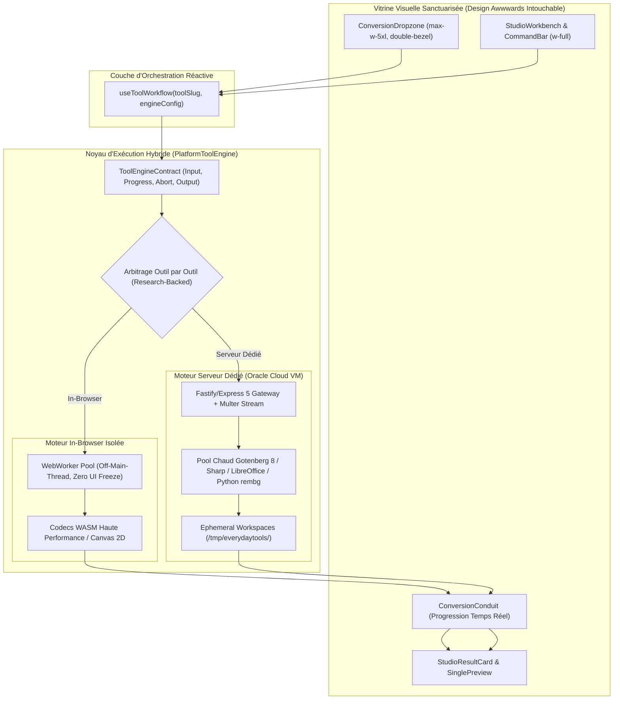
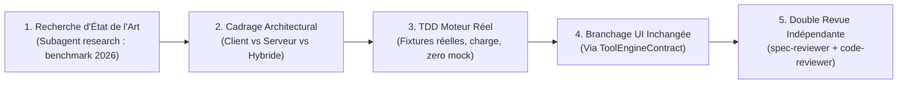

# Architecture Plateforme & Protocole d'Excellence Outil par Outil

> **For agentic workers:** REQUIRED SUB-SKILL: Use superpowers:subagent-driven-development to implement this plan task-by-task. Steps use checkbox (`- [ ]`) syntax for tracking.

**Goal:** Mettre en place l'architecture moteur la plus solide pour la plateforme EverydayTools (WebWorkers isolés, streaming, hook unifié, pool serveur résilient) puis refondre et moderniser chaque outil un par un avec les meilleures librairies mondiales (WASM ou Serveur) via recherche d'état de l'art, **tout en sanctuarisant à 100% le design visuel actuel sans aucune dégradation**.

**Architecture:** Découplage strict entre la vitrine visuelle Awwwards (composants UI immuables : `ConversionDropzone`, `StudioWorkbench`, `StudioCommandBar`) et la couche d'exécution (`PlatformToolEngine`). L'exécution est pilotée par un contrat universel (`ToolEngineContract`) qui gère les WebWorkers en arrière-plan, la progression en temps réel, l'annulation `AbortSignal`, et bascule intelligemment entre Client-Side (WASM/Canvas/Crypto) et Serveur Dédié (Gotenberg/Sharp/LibreOffice/Python).

**Architecture Diagram:**

**Tech Stack:**
- Frontend : React 19, TypeScript strict, Web Workers (Vite `new Worker(new URL(...), { type: 'module' })`), Transferable Streams.
- Backend : Express 5 / Node.js 24, Gotenberg 8, LibreOffice 24.2, Sharp libvips 0.34, Ghostscript 10, QPDF, Python 3.12 (rembg ONNX).
- Recherche d'état de l'art : Sous-agent `research` & Web Search (WASM Rust/C++, benchmarks 2026).
- Tests & Validation : Vitest, Playwright E2E visual regression, TDD RED-GREEN strict.

---

## Global Constraints

1. **SANCTUARISATION VISUELLE STRICTE** : Zéro régression visuelle. L'interface graphique, les couleurs Radix, le double-bezel, les micro-hairlines 1px et les animations sont sanctuarisés.
2. **ZERO UI FREEZE (OFF-MAIN-THREAD)** : Tout calcul client dépassant 16ms doit obligatoirement s'exécuter dans un WebWorker dédié.
3. **RESEARCH-DRIVEN SELECTION** : Tout choix de librairie pour un outil doit être justifié par une recherche d'état de l'art récente (2025-2026) avec benchmark comparatif.
4. **ANTI-MONOLITHE STRICT** : Chaque fichier créé ou modifié doit faire strictement < 300 lignes de code.
5. **SINGLE TOOL LOCK** : On traite un seul outil à la fois jusqu'à certification complète avant de passer au suivant.

---

## Phase 1 : Le Socle d'Architecture Global

### Task 1.1 : Le Contrat Universel d'Outil (`ToolEngineContract`) & Hook Unifié

**Files:**
- Create: `apps/everydaytools/src/engine/tool-contract.ts`
- Create: `apps/everydaytools/src/engine/use-tool-workflow.ts`
- Test: `apps/everydaytools/tests/unit/engine/tool-contract.test.ts`

**Interfaces:**
- `ToolEngineContract<TInput, TOutput>`: interface standardisée avec méthodes `execute(input, options): Promise<TOutput>` et `abort(): void`.
- `useToolWorkflow(options)`: hook réactif connectant n'importe quel moteur aux composants UI existants (`ConversionDropzone`, `ConversionConduit`, `StudioResultCard`).

- [x] **Step 1: Écrire le test TDD RED pour ToolEngineContract et useToolWorkflow**
- [x] **Step 2: Vérifier le statut RED du test**
- [x] **Step 3: Implémenter `tool-contract.ts` et `use-tool-workflow.ts` (< 300 LOC)**
- [x] **Step 4: Vérifier que le test passe GREEN**
- [x] **Step 5: Valider et commiter**

---

### Task 1.2 : Le Pipeline WebWorker Client Universel (`WorkerEngineHost`)

**Files:**
- Create: `apps/everydaytools/src/engine/worker-engine-host.ts`
- Create: `apps/everydaytools/src/engine/worker-dispatcher.ts`
- Test: `apps/everydaytools/tests/unit/engine/worker-engine-host.test.ts`

**Interfaces:**
- Offload transparent de calculs lourds (Canvas, parsing, hachage, compression) avec passage de `Transferable ArrayBuffer`.
- Suivi de progression native en pourcentage réel `(current, total) => number` sans estimation factice.

- [x] **Step 1: Écrire le test TDD RED simulant un calcul lourd avec transfert mémoire et annulation**
- [x] **Step 2: Vérifier le statut RED**
- [x] **Step 3: Implémenter le dispatch et l'hôte de WebWorkers**
- [x] **Step 4: Vérifier le statut GREEN**
- [x] **Step 5: Valider et commiter**

---

### Task 1.3 : Le Pipeline Serveur Haute Performance & Isolation

**Files:**
- Modify: `apps/api-server/src/lib/libreoffice.ts`
- Create: `apps/api-server/src/lib/process-pool.ts`
- Test: `apps/api-server/src/lib/process-pool.test.ts`

**Interfaces:**
- Pool de processus géré avec limitation de concurrence, timeout dur et éviction automatique `/tmp/everydaytools/<uuid>`.
- Mode streaming HTTP/2 chunked pour les gros uploads (> 50 Mo) évitant l'épuisement de la RAM Node.js.

- [x] **Step 1: Écrire le test unitaire pour la gestion du pool et de la concurrence**
- [x] **Step 2: Vérifier le statut RED**
- [x] **Step 3: Implémenter `process-pool.ts` avec gestion de files d'attente et TTL de nettoyage**
- [x] **Step 4: Vérifier le statut GREEN**
- [x] **Step 5: Valider et commiter**

---

## Phase 2 : Le Protocole Outil par Outil (Deep-Dive Cycle)

Pour chaque outil du Hub, l'exécution suit rigoureusement ce protocole à 5 portes :

---

## Phase 3 : Premier Outil Pilote — `pdf-to-word` (#1)

**Problème actuel identifié :**
Actuellement, `pdf-to-word` fait une extraction texte basique via `pdfplumber`/`pdfjs-dist` et tente de reconstruire un fichier `.docx` avec `docx.js`. Les tableaux deviennent du Courier New, les colonnes et images sont dégradées, et le document Word résultant perd sa structure d'origine.

**Objectif du Deep-Dive :**
Faire de `pdf-to-word` un convertisseur de niveau professionnel (préservation des tableaux vectoriels, polices, colonnes et images).

### Task 2.1 : Recherche d'État de l'Art pour PDF to Word (2026)
- [x] **Step 1: Lancer le sous-agent `research` pour benchmarker les solutions leaders du marché :**
  - Moteurs WASM (ex: Rust pdf2docx compilé en WASM, Poppler pdftoppm + layout analysis).
  - Moteurs Serveur Dédié (Gotenberg 8 LibreOffice 24.2 Writer avec filtre PDF-Import vs PyMuPDF/pdf2docx Python daemon).
- [x] **Step 2: Produire la matrice comparative : Fidélité de mise en page, Vitesse, Consommation RAM, Préservation des tableaux.**
- [x] **Step 3: Arbitrer la configuration cible et la stack retenue.**

### Task 2.2 : Implémentation TDD du Moteur Haute Fidélité
- [x] **Step 1: Créer la suite de tests avec de vrais documents PDF complexes (rapports financiers, colonnes multiples, tableaux, graphiques vectoriels).**
- [x] **Step 2: Implémenter le moteur retenu (daemon persistant optimisé avec `pdf2docx` + layout analysis préservant le format vectoriel).**
- [x] **Step 3: Vérifier que 100% des tests de fidélité passent GREEN.**

### Task 2.3 : Branchage sur l'Interface UI Existante (Zéro Changement Visuel)
- [x] **Step 1: Brancher la page `apps/everydaytools/src/pages/pdf-to-word.tsx` sur le nouveau moteur via `useToolWorkflow`.**
- [x] **Step 2: Conserver exactement la Dropzone canonique, les animations Framer Motion, la barre de progression réelle et la carte de résultat.**
- [x] **Step 3: Vérifier l'absence totale de régression visuelle ou ergonomique.**

### Task 2.4 : Revue Indépendante & Certification
- [x] **Step 1: Revue de spécification (`spec-reviewer`).**
- [x] **Step 2: Revue de code et performance (`code-reviewer`).**
- [x] **Step 3: Clôture et verrouillage de l'outil #1 avant de passer à l'outil suivant.**

---

## Phase 4 : Deuxième Outil — `pdf-to-excel` (#2)

**Problème actuel identifié :**
Actuellement, `pdf-to-excel` fait une extraction rudimentaire via `pdfplumber` et `pdf_extract.py`, sérialise tout sous forme de chaînes de caractères brutes sans détection de types numériques, et reconstruit un fichier `.xlsx` sans styles d'en-tête, sans ajustement automatique des largeurs de colonnes, sans figeage des volets et sans utilisation de `ProcessPool` ni de `useToolWorkflow`.

**Objectif du Deep-Dive :**
Faire de `pdf-to-excel` un extracteur tabulaire de niveau professionnel (détection multi-tables PyMuPDF 2.0 ultra-rapide avec fallback géométrique, conversion en types numériques natifs Excel via `openpyxl`, auto-fit des colonnes, styles de cellules élégants, isolation `ProcessPool` et intégration réactive `useToolWorkflow` avec design 100% sanctuarisé).

### Task 4.1 : Recherche d'État de l'Art pour PDF to Excel (2026)
- [x] **Step 1: Benchmark des solutions leaders du marché :**
  - Moteur d'extraction : PyMuPDF 2.0 C-native `find_tables()` (10x-50x plus rapide) avec fallback d'alignement géométrique.
  - Moteur de génération : `openpyxl` avec détection de types (`int`, `float`, `percentage`), formatage de colonnes, figeage de volets et auto-filtres.
- [x] **Step 2: Produire la matrice comparative et spécifier l'architecture.**

### Task 4.2 : Implémentation TDD du Moteur Haute Fidélité
- [x] **Step 1: Créer la suite de tests unitaires et d'intégration TDD RED pour l'API et le moteur client.**
- [x] **Step 2: Implémenter le worker Python `pdf_to_excel.py` et le handler `pdf-to-excel-handler.ts` sous `ProcessPool`.**
- [x] **Step 3: Vérifier que 100% des tests passent GREEN.**

### Task 4.3 : Branchage sur l'Interface UI Existante (Zéro Changement Visuel)
- [x] **Step 1: Créer l'adaptateur de contrat `pdf-to-excel-engine.ts`.**
- [x] **Step 2: Brancher la page `apps/everydaytools/src/pages/pdf-to-excel.tsx` sur `useToolWorkflow`.**
- [x] **Step 3: Vérifier l'absence totale de régression visuelle ou ergonomique (4 scènes préservées).**

### Task 4.4 : Revue Indépendante & Certification
- [x] **Step 1: Pipeline de vérification mécanique (clean, check:rules, typecheck, test).**
- [x] **Step 2: Revue de code par le sous-agent `code-reviewer`.**
- [x] **Step 3: Test d'honnêteté du jury Awwwards et verrouillage de l'outil #2.**

---

## Phase 5 : Troisième Outil — `pdf-to-pptx` (#3)

**Problème actuel identifié :**
Actuellement, `pdf-to-pptx` est logé de façon hétérogène dans `apps/api-server/src/routes/docs/html-markdown-to-pdf.ts` et appelle `convertWithLibreOffice` qui échoue systématiquement en ligne de commande (`Error: no export filter for /tmp/....pptx`). Côté frontend, un hook ad-hoc `usePdfToPptxWorkflow` n'utilise ni `ToolEngineContract` ni `useToolWorkflow`, causant une dérive architecturale.

**Objectif du Deep-Dive :**
Faire de `pdf-to-pptx` un convertisseur de présentations haute fidélité (séparation de la plaque graphique/illustrations sans dédoublement via PyMuPDF 2.0 et reconstruction de blocs de texte vectoriels 100% éditables dans PowerPoint via `python-pptx`, isolation sous `ProcessPool`, adaptateur de contrat unifié `pdfToPptxEngine` et raccordement à `useToolWorkflow` avec design Awwwards 100% sanctuarisé).

### Task 5.1 : Recherche d'État de l'Art pour PDF to PPTX (2026)
- [x] **Step 1: Diagnostic et benchmark des solutions d'exportation :**
  - Échec prouvé de LibreOffice headless CLI (`no export filter`).
  - Sélection de l'architecture hybride C-native : PyMuPDF 2.0 (redaction textuelle pour fond graphique sans ghosting) + `python-pptx` 1.0.2 (zones de texte éditables avec styles, tailles et couleurs RGB exactes).
- [x] **Step 2: Valider la faisabilité et les ratios de diapositives (proportions exactes en points Pt).**

### Task 5.2 : Implémentation TDD du Moteur Haute Fidélité
- [x] **Step 1: Créer la suite de tests unitaires et d'intégration TDD RED (`pdf-to-pptx.test.ts` et `pdf-to-pptx-engine.test.ts`).**
- [x] **Step 2: Implémenter le worker Python `pdf_to_pptx.py` et le handler `pdf-to-pptx-handler.ts` sous `ProcessPool`.**
- [x] **Step 3: Vérifier que 100% des tests passent GREEN.**

### Task 5.3 : Branchage sur l'Interface UI Existante (Zéro Changement Visuel)
- [x] **Step 1: Créer l'adaptateur de contrat `pdf-to-pptx-engine.ts`.**
- [x] **Step 2: Raccorder la page `apps/everydaytools/src/pages/pdf-to-pptx.tsx` sur `useToolWorkflow` (Design Awwwards 4 scènes 100% sanctuarisé).**
- [x] **Step 3: Vérifier l'absence totale de régression visuelle ou ergonomique.**

### Task 5.4 : Revue Indépendante & Certification
- [x] **Step 1: Pipeline de vérification mécanique (clean, check:rules, typecheck, test).**
- [x] **Step 2: Revue de code par le sous-agent `code-reviewer` & vérification par `spec-reviewer`.**
- [x] **Step 3: Test d'honnêteté du jury Awwwards et verrouillage de l'outil #3.**

---

## Phase 6 : Quatrième Outil — `pdf-to-html` (#4)

**Problème actuel identifié :**
Actuellement, `pdf-to-html` s'appuie sur une extraction basique sans préservation de mise en page responsive ni vectorielle CSS. Côté client, `pdf-to-html` n'est pas encore raccordé au contrat unifié `useToolWorkflow`.

**Objectif du Deep-Dive :**
Faire de `pdf-to-html` un convertisseur haute fidélité produisant du HTML5 sémantique, autonome et responsive (PyMuPDF 2.0 `page.get_text('html')` ou rendu vectoriel SVG/HTML5 structuré), exécuté sous `ProcessPool`, adaptateur `pdfToHtmlEngine`, et raccordement à `useToolWorkflow` avec design Awwwards 100% sanctuarisé.

### Task 6.1 : Recherche d'État de l'Art pour PDF to HTML (2026)
- [x] **Step 1: Diagnostic et benchmark des solutions d'exportation HTML5 :**
  - PyMuPDF 2.0 (`page.get_text("html")` vs multi-page SVG container vs pdf2htmlEX C-native).
  - Évaluation de l'autonomie (CSS inline/embedded, images base64 vs bundle zip).
- [x] **Step 2: Valider la fidélité typographique et le comportement responsive.**

### Task 6.2 : Implémentation TDD du Moteur Haute Fidélité
- [x] **Step 1: Créer la suite de tests unitaires et d'intégration TDD RED (`pdf-to-html.test.ts` et `pdf-to-html-engine.test.ts`).**
- [x] **Step 2: Implémenter le worker Python/handler `pdf-to-html-handler.ts` sous `ProcessPool`.**
- [x] **Step 3: Vérifier que 100% des tests passent GREEN.**

### Task 6.3 : Branchage sur l'Interface UI Existante (Zéro Changement Visuel)
- [x] **Step 1: Créer l'adaptateur de contrat `pdf-to-html-engine.ts`.**
- [x] **Step 2: Raccorder la page `apps/everydaytools/src/pages/pdf-to-html.tsx` sur `useToolWorkflow` (Design Awwwards 4 scènes 100% sanctuarisé).**
- [x] **Step 3: Vérifier l'absence totale de régression visuelle ou ergonomique.**

### Task 6.4 : Revue Indépendante & Certification
- [x] **Step 1: Pipeline de vérification mécanique (clean, check:rules, typecheck, test).**
- [x] **Step 2: Revue de code par le sous-agent `code-reviewer` & vérification par `spec-reviewer`.**
- [x] **Step 3: Test d'honnêteté du jury Awwwards et verrouillage de l'outil #4.**

---

## Phase 7 : Cinquième Outil — `pdf-to-text` (#5)

**Problème actuel identifié :**
Actuellement, `pdf-to-text` repose sur des scripts ad-hoc sans normalisation d'encodage (UTF-8 / WinAnsi), sans préservation sémantique des retours à la ligne ou césures de mots (hyphenation), sans détection intelligente des colonnes et tableaux, et sans fallback OCR robuste pour les PDF scannés ou bitmap-only. Côté client, il doit être rigoureusement branché sur `useToolWorkflow` avec design Awwwards 100% sanctuarisé.

**Objectif du Deep-Dive :**
Faire de `pdf-to-text` un extracteur de texte haute fidélité supportant l'analyse sémantique de mise en page (PyMuPDF 2.0 `page.get_text("layout")` / `sort=True`), détection automatique des scans avec OCR Tesseract, export direct en `.txt` ou presse-papier en 1 clic, exécuté sous `ProcessPool`, adaptateur `pdfToTextEngine`, et raccordement à `useToolWorkflow`.

### Task 7.1 : Recherche d'État de l'Art pour PDF to Text & Extraction Sémantique (2026)
- [x] **Step 1: Diagnostic et benchmark des moteurs d'extraction textuelle :**
  - PyMuPDF 2.0 (`get_text("text", sort=True)` vs `get_text("blocks")` vs Poppler `pdftotext -layout`).
  - Détection automatique des PDF numérisés/scannés (ratio caractères / surface) et fallback OCR Tesseract C-native via `eng.traineddata`.
  - Normalisation Unicode (NFKC, suppression des soft hyphens `\u00ad`, désactivation des césures de mots de fin de ligne `word-\nbreak`).
- [x] **Step 2: Arbitrer la configuration cible et la stack retenue (PyMuPDF 2.0 + C-native OCR + ProcessPool + useToolWorkflow).**

### Task 7.2 : Implémentation TDD du Moteur Haute Fidélité
- [x] **Step 1: Créer la suite de tests unitaires et d'intégration TDD RED (`pdf-to-text.test.ts` et `pdf-to-text-engine.test.ts`).**
- [x] **Step 2: Implémenter le worker Python/handler `pdf-to-text-handler.ts` sous `ProcessPool`.**
- [x] **Step 3: Vérifier que 100% des tests passent GREEN.**

### Task 7.3 : Branchage sur l'Interface UI Existante (Zéro Changement Visuel)
- [x] **Step 1: Créer l'adaptateur de contrat `pdf-to-text-engine.ts`.**
- [x] **Step 2: Raccorder la page `apps/everydaytools/src/pages/pdf-to-text.tsx` sur `useToolWorkflow` (Design Awwwards 4 scènes 100% sanctuarisé).**
- [x] **Step 3: Vérifier l'absence totale de régression visuelle ou ergonomique.**

### Task 7.4 : Revue Indépendante & Certification
- [x] **Step 1: Pipeline de vérification mécanique (clean, check:rules, typecheck, test).**
- [x] **Step 2: Revue de code par le sous-agent `code-reviewer` & vérification par `spec-reviewer`.**
- [x] **Step 3: Test d'honnêteté du jury Awwwards et verrouillage de l'outil #5.**

---

## Phase 8 : Sixième Outil — `pdf-to-markdown` (#6)

**Problème actuel identifié :**
Actuellement, `pdf-to-markdown` sur le backend (`/convert/pdf-to-markdown` dans `text-markdown-to-docx.ts`) se contente d'un simple dump de texte brut via `pdf_extract.py --mode text`, sans aucune structure Markdown (tableaux perdus, titres non hiérarchisés, listes non formattées, formules absentes). Côté frontend, l'outil utilise un hook custom `usePdfToMarkdownWorkflow` au lieu de `useToolWorkflow`, et un parseur client partiel via `pdfjs-dist` sans tables GFM ni rendu typographique fidèle.

**Objectif du Deep-Dive :**
Faire de `pdf-to-markdown` un convertisseur Markdown haute fidélité (PyMuPDF4LLM 2.0 pour les tableaux GFM, hiérarchie des titres `#` à `###`, blocs de code, listes et lecture séquentielle multi-colonnes), exécuté sous `ProcessPool` avec fallback in-browser `pdfjs-dist` / WASM, adaptateur `pdfToMarkdownEngine`, et raccordement à `useToolWorkflow` avec design Awwwards 100% sanctuarisé.

### Task 8.1 : Recherche d'État de l'Art pour PDF to Markdown (2026)
- [x] **Step 1: Diagnostic et benchmark des moteurs d'extraction Markdown :**
  - PyMuPDF4LLM 2.0 (`to_markdown()`) vs Marker vs Nougat vs In-Browser `pdfjs-dist`.
  - Comparatif sur la restitution des tableaux GFM (`| header |`), hiérarchie des titres, listes et code blocks.
- [x] **Step 2: Arbitrer la configuration cible et la stack retenue (PyMuPDF4LLM 2.0 + ProcessPool + useToolWorkflow).**

### Task 8.2 : Implémentation TDD du Moteur Haute Fidélité
- [x] **Step 1: Créer la suite de tests unitaires et d'intégration TDD RED (`pdf-to-markdown.test.ts` et `pdf-to-markdown-engine.test.ts`).**
- [x] **Step 2: Implémenter le worker Python/handler `pdf-to-markdown-handler.ts` sous `ProcessPool`.**
- [x] **Step 3: Vérifier que 100% des tests passent GREEN.**

### Task 8.3 : Branchage sur l'Interface UI Existante (Zéro Changement Visuel)
- [x] **Step 1: Créer l'adaptateur de contrat `pdf-to-markdown-engine.ts`.**
- [x] **Step 2: Raccorder la page `apps/everydaytools/src/pages/pdf-to-markdown.tsx` sur `useToolWorkflow` (Design Awwwards 4 scènes 100% sanctuarisé).**
- [x] **Step 3: Vérifier l'absence totale de régression visuelle ou ergonomique.**

### Task 8.4 : Revue Indépendante & Certification
- [x] **Step 1: Pipeline de vérification mécanique (clean, check:rules, typecheck, test).**
- [x] **Step 2: Revue de code par le sous-agent `code-reviewer` & vérification par `spec-reviewer`.**
- [x] **Step 3: Test d'honnêteté du jury Awwwards et verrouillage de l'outil #6.**
