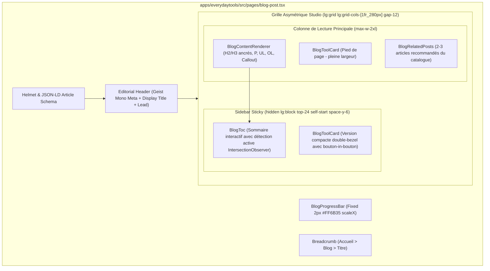

# Redesign Page Blog Post — Studio Éditorial & Anti-Slop

> **For agentic workers:** REQUIRED SUB-SKILL: Use superpowers:subagent-driven-development to implement this plan task-by-task. Steps use checkbox (`- [ ]`) syntax for tracking.

**Goal:** Transformer la page d'article de blog (`apps/everydaytools/src/pages/blog-post.tsx`) d'un rendu basique en une expérience de lecture éditoriale de calibre Linear/Apple/Raycast, conforme au Design System Contract (typographie suisse, barre de progression discrète, Table des Matières active, carte outil double-bezel sans slop, articles connexes) et découpée selon la règle Anti-Monolithe (< 300 lignes par fichier).

**Architecture:** Découpage modulaire en sous-composants spécialisés sous `apps/everydaytools/src/components/blog/` orchestrés par `blog-post.tsx`. La page adopte une grille asymétrique responsive (colonne de lecture centrale max-w-2xl + sidebar latérale sticky avec TOC active et carte outil double-bezel). Les blocs de contenu sont stylisés sans style inline avec des ancres HTML automatiques.

**Architecture Diagram:**

**Tech Stack:** React 19, Tailwind CSS v4, Lucide React, Wouter, React Helmet Async, Vitest + Testing Library.

**Spec:** Contrat de design EverydayTools Hub (`docs/contracts/design-system-contract.md`), doctrine Anti-UI-Slop, Awwwards Jury Gate.

## Global Constraints
- Règle Anti-Monolithe stricte : chaque fichier TypeScript/TSX doit faire < 300 lignes de code.
- Zero AI-slop : zéro badge décoratif pill-slop, zéro emoji dans l'UI, zéro allégation fausse ("100% client-side" interdite).
- Respect du thème clair/sombre via variables CSS (`--bg-base`, `--bg-surface`, `--text-primary`, `--text-secondary`, `--accent`).
- Double-Bezel mathématique pour la carte outil : rayon concentrique $R_{\text{int}} = R_{\text{ext}} - P$.
- Validation TDD RED-GREEN obligatoire : tests unitaires créés avant implémentation.
- Validation Awwwards Jury Gate préalable à la livraison.

---

### Task 1: Composant `BlogProgressBar` (TDD RED -> GREEN)

**Files:**
- Create: `apps/everydaytools/tests/unit/ui/blog-progress-bar.test.tsx`
- Create: `apps/everydaytools/src/components/blog/blog-progress-bar.tsx`

**Interfaces:**
- Produces: `export function BlogProgressBar(): JSX.Element`

- [ ] **Step 1: Écrire le test unitaire failing (RED)**
Tester que la barre de progression se monte avec le rôle accessible ou la balise appropriée, `aria-hidden="true"`, couleur `--accent`, et qu'elle met à jour son `scaleX` selon la position de défilement de la page.

- [ ] **Step 2: Exécuter le test pour vérifier l'échec**
`pnpm vitest run tests/unit/ui/blog-progress-bar.test.tsx` -> Doit échouer car le composant n'existe pas.

- [ ] **Step 3: Implémenter `blog-progress-bar.tsx`**
Barre ultra-fine (2px) fixée en haut (`top: 0, left: 0, right: 0, z-index: 50`), avec `transformOrigin: "left"`, pilotée par un listener scroll passif throttlé via `requestAnimationFrame`.

- [ ] **Step 4: Exécuter le test pour vérifier le succès (GREEN)**
`pnpm vitest run tests/unit/ui/blog-progress-bar.test.tsx` -> Doit passer GREEN.

- [ ] **Step 5: Git commit**
`git commit -m "feat(blog): add BlogProgressBar component with scroll-linked scaleX"`

---

### Task 2: Composant `BlogToc` — Table des Matières Active (TDD RED -> GREEN)

**Files:**
- Create: `apps/everydaytools/tests/unit/ui/blog-toc.test.tsx`
- Create: `apps/everydaytools/src/components/blog/blog-toc.tsx`

**Interfaces:**
- Consumes: `ContentBlock[]` depuis `@/config/blog-data`
- Produces: `export function BlogToc({ blocks }: { blocks: ContentBlock[] }): JSX.Element | null`

- [ ] **Step 1: Écrire le test unitaire failing (RED)**
Tester que :
1. `BlogToc` extrait correctement tous les blocs de type `h2` et `h3` avec des slugs d'ancres uniques.
2. N'affiche rien si aucun titre n'est présent.
3. Rendu accessible (`nav[aria-label="Table des matières"]`).
4. Met en valeur le lien actif avec un indicateur net et une couleur `--accent` ou `--text-primary`.
5. Permet le défilement fluide vers l'ancre lors du clic.

- [ ] **Step 2: Exécuter le test pour vérifier l'échec**
`pnpm vitest run tests/unit/ui/blog-toc.test.tsx` -> Doit échouer.

- [ ] **Step 3: Implémenter `blog-toc.tsx`**
Composant soigné, épuré, style Swiss Studio :
- Titre de section compact en Geist Mono (`SOMMAIRE` / `TABLE OF CONTENTS`, text-xs, tracking-widest).
- Liste hiérarchisée (indentation légère pour les H3).
- Tracking actif de la section visible via `IntersectionObserver`.
- Micro-interactions fluides sur hover.

- [ ] **Step 4: Exécuter le test pour vérifier le succès (GREEN)**
`pnpm vitest run tests/unit/ui/blog-toc.test.tsx` -> Doit passer GREEN.

- [ ] **Step 5: Git commit**
`git commit -m "feat(blog): add dynamic BlogToc component with anchor tracking"`

---

### Task 3: Composant `BlogToolCard` — Passerelle Outil Double-Bezel (TDD RED -> GREEN)

**Files:**
- Create: `apps/everydaytools/tests/unit/ui/blog-tool-card.test.tsx`
- Create: `apps/everydaytools/src/components/blog/blog-tool-card.tsx`

**Interfaces:**
- Consumes: `toolSlug: string`, `label: string`, `variant?: "sidebar" | "banner"`
- Produces: `export function BlogToolCard(props: BlogToolCardProps): JSX.Element`

- [ ] **Step 1: Écrire le test unitaire failing (RED)**
Tester que :
1. La carte affiche le lien vers `/${toolSlug}`.
2. Contient le bouton d'action avec le motif "Button-in-Button" (texte d'action + flèche dans un cercle distinct).
3. N'affiche AUCUN badge décoratif marketing ("100% client-side", "best tool", etc.).
4. Prend en charge la variante `sidebar` (compacte, intégration verticale) et la variante `banner` (pleine largeur pour fin d'article).
5. Respecte l'architecture concentrique Double-Bezel.

- [ ] **Step 2: Exécuter le test pour vérifier l'échec**
`pnpm vitest run tests/unit/ui/blog-tool-card.test.tsx` -> Doit échouer.

- [ ] **Step 3: Implémenter `blog-tool-card.tsx`**
Conception hardware/machined :
- Shell externe : fond subtil (`bg-zinc-100 dark:bg-zinc-900`), bordure 1px précision (`border-zinc-200 dark:border-white/8`), padding `p-1.5`, arrondi `rounded-2xl`.
- Cœur interne : fond surface (`bg-white dark:bg-zinc-950`), padding `p-4`, arrondi calculé `rounded-[calc(1rem-2px)]`.
- Bouton interactif avec micro-translation haptique de l'icône circulaire au hover.

- [ ] **Step 4: Exécuter le test pour vérifier le succès (GREEN)**
`pnpm vitest run tests/unit/ui/blog-tool-card.test.tsx` -> Doit passer GREEN.

- [ ] **Step 5: Git commit**
`git commit -m "feat(blog): implement machined double-bezel BlogToolCard"`

---

### Task 4: Composant `BlogContentRenderer` — Typographie Éditoriale (TDD RED -> GREEN)

**Files:**
- Create: `apps/everydaytools/tests/unit/ui/blog-content-renderer.test.tsx`
- Create: `apps/everydaytools/src/components/blog/blog-content-renderer.tsx`

**Interfaces:**
- Consumes: `blocks: ContentBlock[]`
- Produces: `export function BlogContentRenderer({ blocks }: { blocks: ContentBlock[] }): JSX.Element`

- [ ] **Step 1: Écrire le test unitaire failing (RED)**
Tester que :
1. Les `h2` et `h3` génèrent des attributs `id` cohérents avec la Table des Matières (`scroll-mt-24`).
2. Les paragraphes `p` sont rendus avec la classe éditoriale appropriée.
3. Les listes `ul` et `ol` conservent leur structure avec puces nettes / numéros alignés.
4. Les encarts `callout` sont rendus avec une bordure de précision et une icône sobre, sans couleurs criardes ni style inline.

- [ ] **Step 2: Exécuter le test pour vérifier l'échec**
`pnpm vitest run tests/unit/ui/blog-content-renderer.test.tsx` -> Doit échouer.

- [ ] **Step 3: Implémenter `blog-content-renderer.tsx`**
Rendu haute précision :
- Typographie Bricolage Grotesque / Inter avec ratio d'interlignage équilibré (line-height 1.75).
- Ancrage direct sur les titres pour partage de lien d'ancre au survol.
- Callouts usinés (surface sobre `--bg-elevated`, bordure gauche accentuée ou pourtour micro-hairline).

- [ ] **Step 4: Exécuter le test pour vérifier le succès (GREEN)**
`pnpm vitest run tests/unit/ui/blog-content-renderer.test.tsx` -> Doit passer GREEN.

- [ ] **Step 5: Git commit**
`git commit -m "feat(blog): implement BlogContentRenderer with editorial typography"`

---

### Task 5: Composant `BlogRelatedPosts` — Maillage & Recommandations (TDD RED -> GREEN)

**Files:**
- Create: `apps/everydaytools/tests/unit/ui/blog-related-posts.test.tsx`
- Create: `apps/everydaytools/src/components/blog/blog-related-posts.tsx`

**Interfaces:**
- Consumes: `currentSlug: string`, `lang: "en" | "fr"`
- Produces: `export function BlogRelatedPosts({ currentSlug, lang }: BlogRelatedPostsProps): JSX.Element | null`

- [ ] **Step 1: Écrire le test unitaire failing (RED)**
Tester que :
1. Exclut l'article courant de la liste.
2. Affiche jusqu'à 3 articles pertinents (par mots-clés communs ou récence).
3. Rendu des cartes sous forme de grille sobre (`grid sm:grid-cols-2 lg:grid-cols-3 gap-4`).
4. Chaque carte affiche date, temps de lecture et titre cliquable avec transition fluide au hover.

- [ ] **Step 2: Exécuter le test pour vérifier l'échec**
`pnpm vitest run tests/unit/ui/blog-related-posts.test.tsx` -> Doit échouer.

- [ ] **Step 3: Implémenter `blog-related-posts.tsx`**
Cartes d'archives sobres et rigoureuses, respectant le Design System EverydayTools (surfaces subtiles, transition de bordure au survol, typographie soignée).

- [ ] **Step 4: Exécuter le test pour vérifier le succès (GREEN)**
`pnpm vitest run tests/unit/ui/blog-related-posts.test.tsx` -> Doit passer GREEN.

- [ ] **Step 5: Git commit**
`git commit -m "feat(blog): implement BlogRelatedPosts recommendation grid"`

---

### Task 6: Orchestration Finale de `blog-post.tsx` & Audit Awwwards Jury Gate

**Files:**
- Modify: `apps/everydaytools/src/pages/blog-post.tsx`
- Create/Update: `apps/everydaytools/tests/unit/ui/blog-post-page.test.tsx`

**Interfaces:**
- Intègre `BlogProgressBar`, `BlogToc`, `BlogContentRenderer`, `BlogToolCard`, et `BlogRelatedPosts`.

- [ ] **Step 1: Écrire le test d'intégration de la page `blog-post-page.test.tsx`**
Tester le rendu complet avec routeur Wouter, la présence de la barre de progression, de la sidebar sticky avec TOC, du contenu principal, de la carte outil et des articles connexes.

- [ ] **Step 2: Exécuter le test pour vérifier l'échec initial**
`pnpm vitest run tests/unit/ui/blog-post-page.test.tsx` -> Doit échouer avec l'actuel layout.

- [ ] **Step 3: Refondre `apps/everydaytools/src/pages/blog-post.tsx`**
Remplacement des styles inlines bruts par la nouvelle architecture de mise en page Studio :
- Suppression des inline-styles dispersés.
- En-tête typographique raffiné avec métadonnées techniques en Geist Mono.
- Grille asymétrique moderne (`lg:grid lg:grid-cols-[minmax(0,1fr)_280px] gap-12 items-start`).
- Intégration de la sidebar sticky desktop et repli vertical fluide sur mobile.
- Respect strict de la limite < 300 lignes de code.

- [ ] **Step 4: Exécuter les tests et la chaîne mécanique de vérification**
`pnpm vitest run tests/unit/ui/blog-*.test.tsx`
`pnpm run typecheck`
`pnpm run check:rules`

- [ ] **Step 5: Exécuter le test honnête du Jury Awwwards**
Valider les 3 questions fondamentales :
1. L'exécution visuelle rivalise-t-elle avec Linear / Apple / Raycast ?
2. L'ergonomie est-elle 100% intuitive au premier regard ?
3. L'exécution technique est-elle sans accroc ni friction ?

- [ ] **Step 6: Git commit**
`git commit -m "feat(blog): complete editorial studio redesign of blog post page"`
