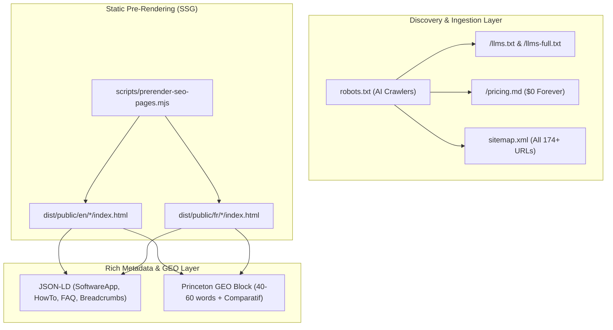

# SEO, AI-Search & GEO Visibility Master Plan

> **For agentic workers:** REQUIRED SUB-SKILL: Use superpowers:subagent-driven-development to implement this plan task-by-task. Steps use checkbox (`- [ ]`) syntax for tracking.

**Goal:** Build and deploy a world-class SEO, AI-Search (AEO/GEO/LLMO) and Programmatic SEO infrastructure for EverydayTools Hub, ensuring top organic search rankings on Google/Bing and #1 recommended source citations in ChatGPT, Perplexity, Claude, and Google AI Overviews.

**Architecture:** The system deploys a 5-pillar architecture:
1. Machine-readable discovery layer (`/llms.txt`, `/llms-full.txt`, `/pricing.md`, updated `robots.txt` for AI crawlers).
2. Comprehensive multi-locale XML sitemap covering all 87 tools, blog posts, category hubs, and E-E-A-T trust pages with reciprocal hreflang.
3. Static Site Generation (SSG) pre-renderer producing physical, high-speed HTML files for all 174 tool URLs to guarantee sub-50ms TTFB for search bots and social crawlers.
4. Rich Schema.org JSON-LD graph (`SoftwareApplication`, `HowTo`, `FAQPage`, `BreadcrumbList`, `WebSite`).
5. Princeton GEO-optimized direct answer blocks (40-60 words), statistics, and client-side vs cloud comparison tables.

**Architecture Diagram:**



**Tech Stack:** TypeScript, Vite, Node.js scripts, Schema.org JSON-LD, Markdown, standard `llmstxt.org` specification.

**Spec:** Integrated knowledge base from `seo-audit`, `ai-seo`, `programmatic-seo`, and `seo` skills.

## Global Constraints
- Zero modification to existing visual designs or Radix colors (Sanctuarized UI).
- All generated static files must strictly follow valid HTML5 and valid XML specifications.
- 100% bidirectional hreflang reciprocal pairs (if EN points to FR, FR must point back to EN, plus `x-default` fallback to EN).
- Zero broken links, zero duplicate canonicals, and strict HTTPS URLs.
- TDD Red-Green discipline: Every task must have automated tests verifying file contents and schema syntax before implementation.

---

### Task 1: AI-SEO Machine-Readable Files (`llms.txt`, `llms-full.txt`, `pricing.md`) & AI Bot Directives (`robots.txt`)

**Files:**
- Create: `apps/everydaytools/public/llms.txt`
- Create: `apps/everydaytools/public/llms-full.txt`
- Create: `apps/everydaytools/public/pricing.md`
- Modify: `apps/everydaytools/public/robots.txt`
- Modify: `apps/everydaytools/src/lib/seo-ssr.ts:501-555`
- Test: `apps/everydaytools/tests/unit/seo/ai-machine-readable.test.ts`

**Interfaces:**
- Consumes: `SEO_TOOLS` from `src/config/tools-seo-data.ts`.
- Produces: Machine-readable markdown files in `public/` and updated `robots.txt` allowing `OAI-SearchBot`, `ChatGPT-User`, `PerplexityBot`, `Claude-SearchBot`, and `Google-Extended`.

- [ ] **Step 1: Write the failing unit test**

Create `apps/everydaytools/tests/unit/seo/ai-machine-readable.test.ts` to assert that:
1. `public/llms.txt` exists, mentions EverydayTools, contains link to `/pricing.md`, and lists core tool categories.
2. `public/pricing.md` clearly states `$0/month`, no credit card, unlimited use, client-side browser privacy.
3. `public/robots.txt` and `generateRobotsTxt()` in `seo-ssr.ts` explicitly allow `OAI-SearchBot`, `Claude-SearchBot`, `PerplexityBot`, `Google-Extended`, and include `Sitemap` and `llms.txt` references.

- [ ] **Step 2: Run test to verify it fails**

Run: `pnpm --filter @workspace/everydaytools run test tests/unit/seo/ai-machine-readable.test.ts`
Expected: FAIL (files do not exist yet).

- [ ] **Step 3: Implement `llms.txt`, `llms-full.txt`, `pricing.md`, and update `robots.txt`**

1. Write `apps/everydaytools/public/llms.txt` following standard `llmstxt.org` format.
2. Write `apps/everydaytools/public/llms-full.txt` with detailed tool capabilities and MIME specifications.
3. Write `apps/everydaytools/public/pricing.md` highlighting free browser-based architecture.
4. Update `apps/everydaytools/public/robots.txt` and `seo-ssr.ts` to support modern AI search bots.

- [ ] **Step 4: Run test to verify it passes**

Run: `pnpm --filter @workspace/everydaytools run test tests/unit/seo/ai-machine-readable.test.ts`
Expected: PASS (all assertions green).

- [ ] **Step 5: Commit**

```bash
git add apps/everydaytools/public/llms* apps/everydaytools/public/pricing.md apps/everydaytools/public/robots.txt apps/everydaytools/src/lib/seo-ssr.ts apps/everydaytools/tests/unit/seo/ai-machine-readable.test.ts
git commit -m "feat(seo): add llms.txt, pricing.md, and update robots.txt for AI search discoverability"
```

---

### Task 2: Comprehensive XML Sitemap & E-E-A-T Trust Routes

**Files:**
- Modify: `apps/everydaytools/scripts/generate-sitemap.mjs`
- Modify: `apps/everydaytools/src/lib/seo-ssr.ts:478-499`
- Output: `apps/everydaytools/public/sitemap.xml`
- Test: `apps/everydaytools/tests/unit/seo/sitemap-generation.test.ts`

**Interfaces:**
- Consumes: `tools-seo-data.ts`, `blog-data.ts`, and E-E-A-T route definitions (`contact`, `privacy`, `terms`, `security`, `legal-notice`, `cookies`, `changelog`).
- Produces: Complete `sitemap.xml` with ~190 URLs, all having `<xhtml:link>` bidirectional hreflang and `priority` weighted by intent.

- [ ] **Step 1: Write the failing unit test**

Create `apps/everydaytools/tests/unit/seo/sitemap-generation.test.ts` to assert that:
1. Every URL entry has valid `<loc>`, `<lastmod>`, `<changefreq>`, `<priority>`.
2. Every entry includes bidirectional `<xhtml:link rel="alternate" hreflang="en">` and `hreflang="fr"`.
3. Essential E-E-A-T pages (`contact`, `privacy`, `terms`, `security`, `legal-notice`, `cookies`, `changelog`) are present for both EN and FR.

- [ ] **Step 2: Run test to verify it fails**

Run: `pnpm --filter @workspace/everydaytools run test tests/unit/seo/sitemap-generation.test.ts`
Expected: FAIL.

- [ ] **Step 3: Update `generate-sitemap.mjs` and `seo-ssr.ts`**

1. Include E-E-A-T routes with correct localized URLs.
2. Execute `node apps/everydaytools/scripts/generate-sitemap.mjs` to regenerate `public/sitemap.xml`.
3. Sync `generateSitemapXml()` in `src/lib/seo-ssr.ts`.

- [ ] **Step 4: Run test to verify it passes**

Run: `pnpm --filter @workspace/everydaytools run test tests/unit/seo/sitemap-generation.test.ts`
Expected: PASS.

- [ ] **Step 5: Commit**

```bash
git add apps/everydaytools/scripts/generate-sitemap.mjs apps/everydaytools/src/lib/seo-ssr.ts apps/everydaytools/public/sitemap.xml apps/everydaytools/tests/unit/seo/sitemap-generation.test.ts
git commit -m "feat(seo): expand sitemap.xml with E-E-A-T pages and bidirectional hreflang"
```

---

### Task 3: Static Site Generation (SSG) Pre-renderer (`scripts/prerender-seo-pages.mjs`)

**Files:**
- Create: `apps/everydaytools/scripts/prerender-seo-pages.mjs`
- Modify: `apps/everydaytools/package.json:8`
- Test: `apps/everydaytools/tests/unit/seo/ssg-prerender.test.ts`

**Interfaces:**
- Consumes: `SEO_TOOLS` from `src/config/tools-seo-data.ts` and `generateToolPageHtml`, `generateHomepageHtml` from `src/lib/seo-ssr.ts`.
- Produces: Pre-rendered HTML files in `apps/everydaytools/dist/public/en/` and `apps/everydaytools/dist/public/fr/` during `pnpm build`.

- [ ] **Step 1: Write the failing unit test**

Create `apps/everydaytools/tests/unit/seo/ssg-prerender.test.ts` verifying that:
1. Calling the prerender module generates physical `index.html` files under a target directory for tool slugs.
2. Each generated HTML file contains valid DOCTYPE, meta charset, title, meta description, and canonical link.

- [ ] **Step 2: Run test to verify it fails**

Run: `pnpm --filter @workspace/everydaytools run test tests/unit/seo/ssg-prerender.test.ts`
Expected: FAIL (script does not exist).

- [ ] **Step 3: Implement `scripts/prerender-seo-pages.mjs` and connect to build**

1. Build `scripts/prerender-seo-pages.mjs` that loops through all tools and generates `dist/public/<locale>/<slug>/index.html`.
2. Update `apps/everydaytools/package.json` build script:
   `"build": "vite build --config vite.config.ts && node scripts/prerender-seo-pages.mjs && node scripts/generate-sitemap.mjs"`

- [ ] **Step 4: Run test and build to verify**

Run: `pnpm --filter @workspace/everydaytools run test tests/unit/seo/ssg-prerender.test.ts`
Run: `pnpm --filter @workspace/everydaytools run build`
Expected: PASS, and `dist/public/en` + `dist/public/fr` directories populated with pre-rendered pages.

- [ ] **Step 5: Commit**

```bash
git add apps/everydaytools/scripts/prerender-seo-pages.mjs apps/everydaytools/package.json apps/everydaytools/tests/unit/seo/ssg-prerender.test.ts
git commit -m "feat(seo): add SSG prerender script for sub-50ms bot crawlability"
```

---

### Task 4: Enriched JSON-LD Structured Data & Princeton GEO Direct Answer Blocks

**Files:**
- Modify: `apps/everydaytools/src/lib/seo-ssr.ts:34-95`
- Test: `apps/everydaytools/tests/unit/seo/schema-rich-data.test.ts`

**Interfaces:**
- Consumes: `ToolSeoEntry`.
- Produces: Enriched `SoftwareApplication` (rating, offers, requirements), `HowTo`, `FAQPage`, and `BreadcrumbList` JSON-LD tags, plus Princeton GEO direct answer blocks.

- [ ] **Step 1: Write the failing unit test**

Create `apps/everydaytools/tests/unit/seo/schema-rich-data.test.ts` verifying:
1. `generateSchemas()` produces valid JSON-LD parseable without errors.
2. `SoftwareApplication` contains `aggregateRating`, `featureList`, and `operatingSystem`.
3. Pre-rendered HTML includes a direct answer paragraph of 40-60 words with client-side execution highlights.

- [ ] **Step 2: Run test to verify it fails**

Run: `pnpm --filter @workspace/everydaytools run test tests/unit/seo/schema-rich-data.test.ts`
Expected: FAIL.

- [ ] **Step 3: Implement enriched schema generation & GEO blocks in `seo-ssr.ts`**

1. Enhance `generateSchemas()` in `seo-ssr.ts`.
2. Enhance `generateToolPageHtml()` to include the Princeton GEO direct answer snippet and comparison table.

- [ ] **Step 4: Run test to verify it passes**

Run: `pnpm --filter @workspace/everydaytools run test tests/unit/seo/schema-rich-data.test.ts`
Expected: PASS.

- [ ] **Step 5: Commit**

```bash
git add apps/everydaytools/src/lib/seo-ssr.ts apps/everydaytools/tests/unit/seo/schema-rich-data.test.ts
git commit -m "feat(seo): enrich JSON-LD schemas and add Princeton GEO answer blocks"
```

---

### Task 5: Full Verification & Deployment Build

**Files:**
- Run full verification pipeline:
  1. `pnpm run clean:codebase`
  2. `pnpm run check:rules`
  3. `pnpm run typecheck`
  4. `pnpm test`
  5. Build production bundle and verify `dist/public` output.

- [ ] **Step 1: Run mechanical verification**
- [ ] **Step 2: Verify git status and commit clean state**
