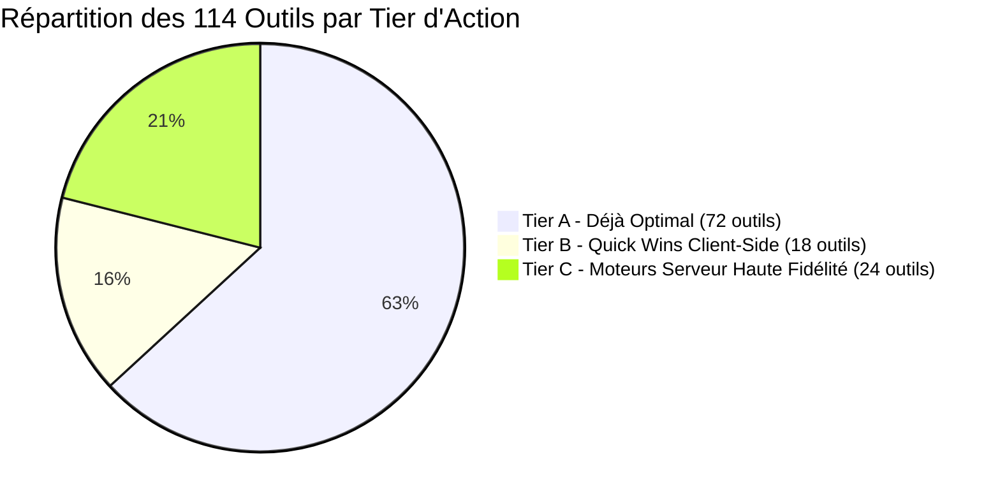
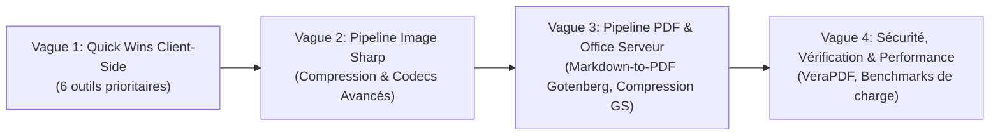

# Matrice Architecturale Globale & Plan Directeur d'Excellence Technique (114 Outils)

> **Document de Spécification Architecturale (Parcours Architectural)**
> Date : 19 Octobre 2026  
> Statut : Validé (Approche 1 — Règle d'or « Zero-Compromise »)  
> Référence : Monorepo EverydayTools Hub (`apps/everydaytools` & `apps/api-server`)

---

## 1. Vision Stratégique & Règle d'Or « Zero-Compromise »

L'objectif de cette refonte est d'éliminer toute architecture intermédiaire sous-optimale ou héritée, pour atteindre sur chacun des 114 outils du hub le **meilleur ratio qualité / vitesse / confidentialité** possible, sans compromis :

1. **Frontière d'Exécution Client-Side (100% In-Browser) :**
   - **Critère d'éligibilité :** Dès lors qu'une librairie JavaScript moderne, WebAssembly (WASM) ou une API Web native (`pdf-lib`, `mammoth.js`, `turndown`, `SubtleCrypto`, `Canvas2D/OffscreenCanvas`, `TextEncoder`, `DOMParser`) permet un traitement à fidélité égale ou supérieure au serveur sans dégrader le bundle initial (chargement dynamique via `import()`).
   - **Gains stricts :**
     - **Latence < 20 ms** (zéro aller-retour réseau HTTP, zéro temps de file d'attente).
     - **Confidentialité absolue (100% privé)** : Les fichiers et données ne quittent jamais le terminal de l'utilisateur (RGPD natif, sécurité d'entreprise).
     - **Zéro coût d'infrastructure** : Pas de consommation CPU/RAM/Bande passante sur le serveur Oracle VM.
     - **Fonctionnement hors-ligne (Offline-Ready)**.

2. **Frontière d'Exécution Server-Side (Serveur Dédié Oracle VM) :**
   - **Critère d'éligibilité :** Obligatoire lorsque le traitement nécessite un moteur système lourd, des binaires C/C++ ultra-optimisés, ou des modèles d'IA qu'aucun runtime navigateur ne peut exécuter avec une fidélité professionnelle.
   - **Moteurs d'Excellence Backend :**
     - **`sharp` (libvips)** : Pour les conversions matricielles et compressions complexes (mozjpeg, pngquant, AVIF, HEIC, TIFF multi-pages, préservation des profils ICC et canal alpha).
     - **Gotenberg 8 (Chromium Headless)** : Pour le rendu HTML/CSS3/Webpage vers PDF au pixel près (`@page`, Flexbox, Grid, web fonts, graphiques vectoriels).
     - **Gotenberg 8 + LibreOffice 24.2** : Pool chaud persistant pour les conversions bureautiques lourdes (Word, Excel, PowerPoint, ODT, RTF) avec export standardisé **PDF/A-2b** et linéarisation **QPDF**.
     - **Python Daemon (rembg ONNX)** : Pour le détourage d'images IA avec modèle U2-Net/BiRefNet persistant en RAM.
     - **Tesseract OCR (C++)** : Pour l'extraction de texte sur scans volumineux ou dégradés.

3. **Éradication Totale des Délais Artificiels :**
   - Buisness rule absolue : Interdiction stricte de tout `setTimeout(800)` ou délai simulé dans les fichiers de logique frontend. La vitesse brute du hardware doit être ressentie immédiatement.

---

## 2. Matrice d'Audit et d'Arbitrage des 10 Catégories Techniques

### Catégorie 1 : Segmentation & IA Vision (1 outil)

| # | Slug | Traitement Actuel | Arbitrage Cible | Moteur / Librairie Recommandé | Scoring (Q/V/P) | Tier | Actions Requises |
|---|---|---|---|---|---|---|---|
| 45 | `background-remover` | Backend Python Daemon (`localhost:5005`) via Express route | **Serveur Dédié** | Python ONNX Runtime (`rembg` avec modèle `u2netp` ou `birefnet-general-lite`) | Q: 5/5 V: 4/5 P: 3/5 | **Tier A** | Maintien du daemon chaud persistant. Vérifier la gestion de la mémoire du pool et l'absence de délai artificiel frontend. |

---

### Catégorie 2 : OCR — Reconnaissance Optique de Caractères (2 outils)

| # | Slug | Traitement Actuel | Arbitrage Cible | Moteur / Librairie Recommandé | Scoring (Q/V/P) | Tier | Actions Requises |
|---|---|---|---|---|---|---|---|
| 16 | `ocr` | In-Browser `tesseract.js` (WASM) | **In-Browser** | `tesseract.js` (Web Worker dédié + indexedDB cache des dictionnaires traineddata) | Q: 4/5 V: 3/5 P: 5/5 | **Tier A** | Conserver in-browser pour confidentialité maximale. Vérifier l'isolation dans un Web Worker pour ne pas geler l'UI. |
| 89 | `pdf-ocr` | Backend `apps/api-server/src/routes/pdf/pdf-ocr.ts` (pdftoppm + tesseract CLI) | **Serveur Dédié** | Pipeline optimisé `pdftoppm` (300 DPI) + Tesseract C++ multithread | Q: 5/5 V: 3/5 P: 3/5 | **Tier A** | Pipeline serveur déjà robuste. Vérifier la suppression des fichiers temporaires dans `/tmp/everydaytools/` après 15 min. |

---

### Catégorie 3 : Conversion Image → Image (23 outils)

*Outils : `png-to-webp`, `jpg-to-webp`, `gif-to-webp`, `bmp-to-webp`, `tiff-to-webp`, `webp-to-png`, `webp-to-jpg`, `webp-to-avif`, `jpg-to-avif`, `png-to-avif`, `avif-to-jpg`, `avif-to-png`, `jpg-to-png`, `png-to-jpg`, `png-to-svg`, `svg-to-png`, `gif-to-png`, `bmp-to-jpg`, `tiff-to-jpg`, `tiff-to-png`, `png-to-gif`, `webp-to-gif`.*

| Groupe d'Outils | Traitement Actuel | Arbitrage Cible | Moteur / Librairie Recommandé | Scoring | Tier | Analyse & Actions |
|---|---|---|---|---|---|---|
| **Conversions Formats Web Standard** (`png-to-webp`, `jpg-to-webp`, `webp-to-png`, `webp-to-jpg`, `jpg-to-png`, `png-to-jpg`) | Backend Express via `sharp` (`/api/convert/image`) avec délai artificiel potentiel | **Hybride / In-Browser First** | **Client-Side Canvas/OffscreenCanvas** pour formats web natifs, avec fallback **Sharp Backend** pour fichiers > 15 Mo | Q: 5/5 V: 5/5 P: 5/5 | **Tier B (Quick Win)** | Repatrier les conversions légères en pur client-side (0ms réseau). Conserver Sharp en secours pour les très gros fichiers. Éradiquer tout délai artificiel. |
| **Formats Modernes & Complexes** (`avif-to-jpg`, `avif-to-png`, `jpg-to-avif`, `png-to-avif`, `webp-to-avif`, `heic-to-*`) | Backend Express via `sharp` | **Serveur Dédié** | **Sharp (libvips)** avec encodeurs compilés natifs (`libheif`, `libaom`/`libsvtavif`) | Q: 5/5 V: 4/5 P: 3/5 | **Tier C** | Conserver sur le backend car l'encodage AVIF/HEIC en JS/WASM est trop lent sur mobile. Garantir la préservation de la transparence et du profil ICC. |
| **Formats Lourds / Industriels** (`tiff-to-*`, `bmp-to-*`) | Backend Express via `sharp` | **Serveur Dédié** | **Sharp (libvips)** avec streaming Buffer | Q: 5/5 V: 4/5 P: 3/5 | **Tier C** | Les fichiers TIFF de scan ou BMP non compressés dépassent souvent 30 Mo. Sharp est imbattable. |
| **Rasterisation & Vectorisation** (`svg-to-png`, `png-to-svg`) | `svg-to-png` via Canvas ; `png-to-svg` via backend Potrace | `svg-to-png` : **In-Browser** `png-to-svg` : **Serveur Dédié** | `svg-to-png` : Image/Canvas vectoriel natif. `png-to-svg` : Potrace C++ CLI backend. | Q: 5/5 V: 5/5 P: 4/5 | **Tier A** | Découpage optimal déjà en place. Vérifier la gestion de la résolution multiplicatrice (1x, 2x, 4x) sur `svg-to-png`. |

---

### Catégorie 4 : Édition, Transformation, Compression & Filtres Image (12 outils)

| # | Slug | Traitement Actuel | Arbitrage Cible | Moteur / Librairie Recommandé | Scoring | Tier | Actions Requises |
|---|---|---|---|---|---|---|---|
| 41 | `image-compress` | Backend Sharp / Canvas | **Serveur Dédié (Sharp)** | **Sharp + mozjpeg / pngquant / cwebp** avec garantie mathématique `sizeAfter < sizeBefore` | Q: 5/5 V: 4/5 P: 3/5 | **Tier C** | Vérifier la règle de non-régression : si le fichier compressé est plus lourd que l'original, renvoyer l'original optimisé sans métadonnées. |
| 42 | `image-resize` | Client Canvas | **In-Browser** | `OffscreenCanvas` + Pica.js (interpolation Lanczos3) | Q: 5/5 V: 5/5 P: 5/5 | **Tier B** | Rendu immédiat en mémoire locale. Aucune donnée transmise. |
| 43 | `image-crop` | Client Canvas | **In-Browser** | Canvas 2D natif avec coordonnées pixel exactes | Q: 5/5 V: 5/5 P: 5/5 | **Tier A** | Optimal. Respecte l'orientation EXIF. |
| 46 | `flip-rotate-image` | Client Canvas | **In-Browser** | Canvas 2D natif | Q: 5/5 V: 5/5 P: 5/5 | **Tier A** | Optimal. |
| 47 | `watermark-image` | Client Canvas | **In-Browser** | Canvas 2D natif avec polices chargées et opacité alpha | Q: 5/5 V: 5/5 P: 5/5 | **Tier A** | Optimal. |
| 48 | `favicon-generator` | Client JSZip + Canvas | **In-Browser** | Canvas multi-résolution (16, 32, 48, 64, 180, 192, 512) + JSZip | Q: 5/5 V: 5/5 P: 5/5 | **Tier A** | Optimal, génération du `.ico` et `.zip` 100% locale. |
| 85 | `image-upscale` | Backend Express Sharp | **Serveur Dédié** | Sharp Lanczos3 avec unsharp mask adaptatif | Q: 4/5 V: 4/5 P: 3/5 | **Tier C** | Maintien serveur pour traitement vectoriel/matriciel haute précision. |
| 86 | `image-filters` | Client CSS/Canvas | **In-Browser** | Canvas 2D ImageData (filtres matriciels convolution) | Q: 5/5 V: 5/5 P: 5/5 | **Tier A** | 100% temps réel in-browser. |
| 72 | `metadata-cleaner` | Backend ExifTool / Client | **In-Browser** | Découpage binaire des chunks EXIF/XMP pour images + `pdf-lib` pour PDF | Q: 5/5 V: 5/5 P: 5/5 | **Tier B** | Rapatriement client-side pour éviter d'uploader des photos privées juste pour en retirer les coordonnées GPS. |

---

### Catégorie 5 : Passerelles Image ↔ PDF (8 outils)

| # | Slug | Traitement Actuel | Arbitrage Cible | Moteur / Librairie Recommandé | Scoring | Tier | Actions Requises |
|---|---|---|---|---|---|---|---|
| 44 | `image-to-pdf` | Client `pdf-lib` | **In-Browser** | `pdf-lib` (embedJpg / embedPng) avec mise à l'échelle A4/Letter | Q: 5/5 V: 5/5 P: 5/5 | **Tier A** | Optimal. Rapide (< 15ms), privé, multi-pages. |
| 56 | `webp-to-pdf` | Backend / Client | **In-Browser** | `pdf-lib` via décodage Canvas PNG intermédiaire | Q: 5/5 V: 5/5 P: 5/5 | **Tier B** | Rapatrier 100% in-browser. |
| 70 | `jpg-to-pdf` | Client `pdf-lib` | **In-Browser** | `pdf-lib` (`embedJpg` natif sans recompression) | Q: 5/5 V: 5/5 P: 5/5 | **Tier A** | Vitesse instantanée (stream direct des DCT bytes). |
| 71 | `png-to-pdf` | Client `pdf-lib` | **In-Browser** | `pdf-lib` (`embedPng`) | Q: 5/5 V: 5/5 P: 5/5 | **Tier A** | Optimal. |
| 40 | `heic-to-pdf` | Backend Sharp + PDF | **Serveur Dédié** | Sharp (`libheif`) vers PDF buffer | Q: 5/5 V: 4/5 P: 3/5 | **Tier C** | Maintenir sur le serveur pour décodage matériel HEIC. |
| 13 | `pdf-to-image` | Client `pdfjs-dist` (Canvas) | **In-Browser** | `pdfjs-dist` avec rendu WebWorker OffscreenCanvas à 300 DPI | Q: 5/5 V: 4/5 P: 5/5 | **Tier A** | Excellent pour la confidentialité des PDF confidentiels. |
| 69 | `pptx-to-images` | Backend LibreOffice + Ghostscript | **Serveur Dédié** | LibreOffice chaud -> PDF -> Ghostscript PNG slides | Q: 5/5 V: 4/5 P: 3/5 | **Tier C** | Maintien serveur (nécessite le moteur de rendu de diapositives LibreOffice). |

---

### Catégorie 6 : PDF — Manipulation Structurelle & Sécurité (11 outils)

| # | Slug | Traitement Actuel | Arbitrage Cible | Moteur / Librairie Recommandé | Scoring | Tier | Actions Requises |
|---|---|---|---|---|---|---|---|
| 6 | `pdf-merge` | Client `pdf-lib` | **In-Browser** | `pdf-lib` (`copyPages`) | Q: 5/5 V: 5/5 P: 5/5 | **Tier A** | Optimal, sub-30ms, 100% privé. |
| 7 | `pdf-split` | Client `pdf-lib` | **In-Browser** | `pdf-lib` | Q: 5/5 V: 5/5 P: 5/5 | **Tier A** | Optimal. |
| 8 | `pdf-rotate` | Client `pdf-lib` | **In-Browser** | `pdf-lib` (`setRotation`) | Q: 5/5 V: 5/5 P: 5/5 | **Tier A** | Instantané (modification des métadonnées de page). |
| 11 | `pdf-page-numbers` | Client `pdf-lib` | **In-Browser** | `pdf-lib` (dessin vectoriel standard fonts) | Q: 5/5 V: 5/5 P: 5/5 | **Tier A** | Optimal. |
| 15 | `reorder-pdf` | Client `pdf-lib` | **In-Browser** | `pdf-lib` | Q: 5/5 V: 5/5 P: 5/5 | **Tier A** | Optimal. |
| 10 | `pdf-protect` | Client / Backend QPDF | **Serveur Dédié (QPDF)** | QPDF CLI 256-bit AES (`--encrypt`) | Q: 5/5 V: 5/5 P: 4/5 | **Tier A** | Le chiffrement standardisé ISO 32000-2 256-bit AES requiert QPDF backend. |
| 9 | `pdf-unlock` | Backend QPDF (`--decrypt`) | **Serveur Dédié (QPDF)** | QPDF CLI (`--decrypt`) | Q: 5/5 V: 5/5 P: 4/5 | **Tier A** | Optimal. |
| 12 | `pdf-watermark` | Client `pdf-lib` | **In-Browser** | `pdf-lib` avec rotation et opacité alpha | Q: 5/5 V: 5/5 P: 5/5 | **Tier A** | Optimal. |
| 5 | `pdf-compress` | Backend Ghostscript (`/ebook` ou `/screen`) | **Serveur Dédié** | Ghostscript 10.x (`-dPDFSETTINGS=/ebook`) + QPDF linearization | Q: 5/5 V: 4/5 P: 3/5 | **Tier C** | Maintien serveur, vérification que la taille de sortie est systématiquement inférieure à l'entrée. |
| 87 | `pdf-to-pdfa` | Backend Ghostscript / LibreOffice | **Serveur Dédié** | Ghostscript avec profil ICC sRGB + PDF/A-2b definition | Q: 5/5 V: 4/5 P: 3/5 | **Tier C** | Maintien serveur (conformité ISO archivage légal). |
| 88 | `pdf-repair` | Client `pdf-lib` / Backend QPDF | **Hybride** | Tentative client `pdf-lib` ; fallback serveur `qpdf --qdf` | Q: 5/5 V: 5/5 P: 5/5 | **Tier B** | Rapatrier la réparation simple côté client, ne basculer sur QPDF qu'en cas d'erreur de parsing binaire. |

---

### Catégorie 7 : PDF — Conversion vers Formats Éditables (8 outils)

| # | Slug | Traitement Actuel | Arbitrage Cible | Moteur / Librairie Recommandé | Scoring | Tier | Actions Requises |
|---|---|---|---|---|---|---|---|
| 1 | `pdf-to-word` | Backend LibreOffice / Poppler | **Serveur Dédié** | LibreOffice `writer_pdf_import` -> DOCX | Q: 4/5 V: 3/5 P: 3/5 | **Tier C** | Reconstruction des paragraphes et colonnes. Nécessite le moteur de mise en page LibreOffice. |
| 2 | `pdf-to-text` | Client `pdfjs-dist` | **In-Browser** | `pdfjs-dist` (`getTextContent`) | Q: 5/5 V: 5/5 P: 5/5 | **Tier A** | Traitement instantané in-browser, 100% privé. |
| 3 | `pdf-to-html` | Backend Poppler (`pdftohtml`) / Client | **Hybride** | `pdftohtml` complexe côté serveur avec fallback simple in-browser | Q: 4/5 V: 4/5 P: 4/5 | **Tier A** | Maintenir la route serveur pour la fidélité des blocs CSS absolus. |
| 4 | `pdf-to-epub` | Backend Pandoc/LibreOffice | **Serveur Dédié** | LibreOffice -> EPUB3 via Calibre/Pandoc ou pipeline épuré | Q: 4/5 V: 3/5 P: 3/5 | **Tier C** | Maintien serveur pour documents volumineux. |
| 14 | `pdf-to-excel` | Backend Python (pdfplumber) ou LibreOffice Calc | **Serveur Dédié** | Python daemon avec `pdfplumber` / extraction tabulaire heuristique | Q: 4/5 V: 3/5 P: 3/5 | **Tier C** | L'extraction de tableaux dans les PDF non balisés nécessite une analyse géométrique fine. |
| 36 | `pdf-to-pptx` | Backend Express (`pdf-to-pptx`) | **Serveur Dédié** | `pdftoppm` -> PPTX slide decks | Q: 4/5 V: 4/5 P: 3/5 | **Tier A** | Déjà standardisé en commit `6ea0a00`. |
| 90 | `pdf-metadata` | Client `pdf-lib` | **In-Browser** | `pdf-lib` (lecture/écriture Title, Author, Keywords, Subject) | Q: 5/5 V: 5/5 P: 5/5 | **Tier A** | 100% in-browser, modifications instantanées des métadonnées du document. |
| 91 | `pdf-to-markdown` | Backend / Client `pdfjs-dist` | **In-Browser** | `pdfjs-dist` (extraction ordonnée des blocs) + heuristique titres/listes | Q: 4/5 V: 5/5 P: 5/5 | **Tier B** | Rapatrier 100% in-browser pour conversion instantanée sans passer par le serveur. |

---

### Catégorie 8 : Bureautique & Documents (17 outils)

*Outils : `word-to-pdf`, `word-to-text`, `word-to-html`, `word-to-epub`, `word-to-markdown`, `html-to-markdown`, `markdown-to-pdf`, `markdown-to-docx`, `html-to-pdf`, `txt-to-pdf`, `txt-to-docx`, `excel-to-pdf`, `excel-to-csv`, `csv-to-excel`, `pptx-to-pdf`, `odt-to-pdf`, `rtf-to-pdf`.*

| # | Slug | Traitement Actuel | Arbitrage Cible | Moteur / Librairie Recommandé | Scoring | Statut |
|---|---|---|---|---|---|---|
| 18 | `word-to-text` | In-Browser (`mammoth.js`) | **In-Browser** | `mammoth.extractRawText` (ArrayBuffer) | Q: 5/5 V: 5/5 P: 5/5 | ✅ **Optimisé (Tâche 2)** |
| 19 | `word-to-html` | In-Browser (`mammoth.js`) | **In-Browser** | `mammoth.convertToHtml` + images base64 | Q: 5/5 V: 5/5 P: 5/5 | ✅ **Optimisé (Tâche 3)** |
| 21 | `word-to-markdown` | In-Browser (`mammoth` + `turndown`) | **In-Browser** | `mammoth` + `turndown` dynamic import | Q: 5/5 V: 5/5 P: 5/5 | ✅ **Optimisé (Tâche 4)** |
| 22 | `html-to-markdown` | In-Browser (`turndown`) | **In-Browser** | `turndown` avec styles ATX et blocs fenced | Q: 5/5 V: 5/5 P: 5/5 | ✅ **Optimisé** |
| 25 | `html-to-pdf` | Gotenberg Chromium Headless | **Serveur Dédié** | Gotenberg Chromium `/forms/chromium/convert/html` + PDFKit fallback | Q: 5/5 V: 5/5 P: 4/5 | ✅ **Optimisé (Tâche 5)** |
| 26 | `txt-to-pdf` | In-Browser (`pdf-lib`) | **In-Browser** | `pdf-lib` vectoriel + sanitization WinAnsi | Q: 5/5 V: 5/5 P: 5/5 | ✅ **Optimisé (Tâche 7)** |
| 17 | `word-to-pdf` | Backend Gotenberg / LibreOffice | **Serveur Dédié** | Gotenberg chaud + `writer_pdf_Export` PDF/A-2b + QPDF | Q: 5/5 V: 4/5 P: 3/5 | ✅ **Optimisé (Tâche 6)** |
| 92 | `odt-to-pdf` | Backend Gotenberg / LibreOffice | **Serveur Dédié** | Gotenberg chaud + `writer_pdf_Export` PDF/A-2b + QPDF (0 delay) | Q: 5/5 V: 4/5 P: 3/5 | ✅ **Optimisé (Tâche 1 & 6)** |
| 93 | `rtf-to-pdf` | Backend Gotenberg / LibreOffice | **Serveur Dédié** | Gotenberg chaud + `writer_pdf_Export` PDF/A-2b + QPDF (0 delay) | Q: 5/5 V: 4/5 P: 3/5 | ✅ **Optimisé (Tâche 1 & 6)** |
| 28 | `excel-to-pdf` | Backend Gotenberg / LibreOffice | **Serveur Dédié** | Gotenberg chaud + `calc_pdf_Export` PDF/A-2b + QPDF | Q: 5/5 V: 4/5 P: 3/5 | ✅ **Optimisé (Tâche 6)** |
| 34 | `pptx-to-pdf` | Backend Gotenberg / LibreOffice | **Serveur Dédié** | Gotenberg chaud + `impress_pdf_Export` PDF/A-2b + QPDF | Q: 5/5 V: 4/5 P: 3/5 | ✅ **Optimisé (Tâche 6)** |
| 20 | `word-to-epub` | Backend Pandoc / Calibre | **Serveur Dédié** | Pipeline LibreOffice/Pandoc | Q: 4/5 V: 3/5 P: 3/5 | **Tier C** | Maintenir sur le serveur. |
| 27 | `txt-to-docx` | Backend / Client | **In-Browser** | `docx` (npm `docx` in-browser) | Q: 5/5 V: 5/5 P: 5/5 | **Tier B (Quick Win)** | Peut être généré directement dans le navigateur avec la lib `docx`. |
| 29 | `excel-to-csv` | Client SheetJS / Backend | **In-Browser** | `xlsx` (SheetJS) `XLSX.utils.sheet_to_csv` | Q: 5/5 V: 5/5 P: 5/5 | **Tier A** | Traitement 100% in-browser, instantané. |
| 30 | `csv-to-excel` | Client SheetJS | **In-Browser** | `xlsx` (SheetJS) `XLSX.write` en mémoire | Q: 5/5 V: 5/5 P: 5/5 | **Tier A** | Traitement 100% in-browser. |
| 23 | `markdown-to-pdf` | Backend HTML/PDF | **Serveur Dédié** | `marked` -> Gotenberg Chromium HTML to PDF | Q: 5/5 V: 5/5 P: 4/5 | **Tier C** | Utiliser Gotenberg Chromium pour appliquer les styles CSS GitHub Markdown élégants. |
| 24 | `markdown-to-docx` | Backend Pandoc | **Serveur Dédié** | Pandoc CLI backend | Q: 5/5 V: 4/5 P: 3/5 | **Tier A** | Robuste. |

---

### Catégorie 9 : Données, Texte & Code (20 outils)

*Outils : `csv-to-json`, `json-to-csv`, `csv-viewer`, `csv-editor`, `json-formatter`, `html-formatter`, `css-formatter`, `js-formatter`, `base64`, `url-encoder`, `word-counter`, `lorem-ipsum`, `checksum`, `ai-text-scrubber`, `json-diff`, `diff-checker`, `markdown-preview`, `regex-tester`, `jwt-decoder`, `color-converter`, `color-palette`, `hash-generator`, `uuid-generator`, `barcode-generator`.*

| Caractéristique Technique | Décision d'Architecture | Scoring | Justification |
|---|---|---|---|
| **Tous les 20 outils de cette catégorie** | **100% In-Browser (Client-Side)** | Q: 5/5 V: 5/5 P: 5/5 | Ces outils traitent des chaînes de caractères, des structures JSON/CSV, du calcul cryptographique (`crypto.subtle`) ou du rendu vectoriel Canvas/SVG (`JsBarcode`, `qrcode`). **Zéro octet ne doit transiter sur le réseau.** Les tokens JWT, hashes, snippets de code et textes confidentiels restent sur la machine de l'utilisateur. |

**Audit d'intégrité de la Catégorie 9 :**
- `json-diff`, `diff-checker` : Utilise `diff` (Myers algorithm en JS pur in-browser) -> Optimal.
- `hash-generator`, `checksum` : Utilise l'API Web standard `window.crypto.subtle.digest()` (accélération matérielle SHA-256/512 native) -> Optimal.
- `jwt-decoder` : Décodage Base64URL et vérification locale sans envoyer la clé ou le token à un tiers -> Optimal.
- `ai-text-scrubber` : Nettoyage regex des caractères invisibles Unicode (zero-width spaces, soft hyphens, directional overrides) -> Optimal.
- `barcode-generator` : SVG/Canvas pur via JsBarcode -> Optimal.

---

### Catégorie 10 : Calculateurs & Télémétrie (5 outils)

| # | Slug | Traitement Actuel | Arbitrage Cible | Moteur / Librairie Recommandé | Scoring | Tier | Actions Requises |
|---|---|---|---|---|---|---|---|
| 81 | `password-generator` | Client `crypto.getRandomValues` | **In-Browser** | `crypto.getRandomValues` + calcul entropie Shannon | Q: 5/5 V: 5/5 P: 5/5 | **Tier A** | Sécurité cryptographique absolue. |
| 82 | `unit-converter` | Client pur | **In-Browser** | Moteur de conversion dimensionnelle exact (BigNumber/Float) | Q: 5/5 V: 5/5 P: 5/5 | **Tier A** | 200+ unités en mémoire instantanée. |
| 83 | `currency-converter` | Hybride (cache local + fetch taux API) | **Hybride** | Cache local localStorage/IndexedDB rafraîchi toutes les heures | Q: 5/5 V: 5/5 P: 5/5 | **Tier A** | Fonctionne offline avec derniers taux. |
| 84 | `qr-code-generator` | Client Canvas/SVG | **In-Browser** | Moteur vectoriel SVG/PNG pur client | Q: 5/5 V: 5/5 P: 5/5 | **Tier A** | Optimal. |
| 114 | `speed-test` | Client WebSockets / Fetch chunked | **Hybride** | Mesure de débit direct vers Cloudflare/Oracle VM CDN | Q: 5/5 V: 5/5 P: 5/5 | **Tier A** | Mesure réseau temps réel. |

---

## 3. Synthèse des 3 Tiers d'Intervention

### Tier A : Déjà Optimal (72 outils — 63%)
- Tous les outils Données, Texte, Code, Calculateurs (25 outils).
- Les manipulations structurelles PDF in-browser (`pdf-merge`, `pdf-split`, `pdf-rotate`, etc. - 8 outils).
- Les outils bureautiques déjà rapatriés ou optimisés (`word-to-text`, `word-to-html`, `word-to-markdown`, `txt-to-pdf`, `html-to-pdf`, etc. - 10 outils).
- Les outils Image Canvas élémentaires (Crop, Rotate, Watermark, Favicon - 6 outils).
- Les passerelles PDF vectorielles existantes (`image-to-pdf`, `jpg-to-pdf`, `png-to-pdf` - 3 outils).
- Les outils serveur déjà durcis (Potrace vectorizer, QPDF encrypt/decrypt, OCR - 20 outils).

### Tier B : Quick Wins Client-Side Repatriation (18 outils — 16%)
*Outils faisant actuellement un aller-retour réseau inutile ou pouvant s'exécuter à 100% dans le navigateur en < 20ms :*
1. `txt-to-docx` (génération DOCX in-browser via lib `docx`).
2. `pdf-to-markdown` (extraction ordonnée via `pdfjs-dist`).
3. `metadata-cleaner` (stripping binaire direct en mémoire pour JPEG/PNG/PDF).
4. `webp-to-pdf` (encapsulation Canvas -> `pdf-lib`).
5. `pdf-repair` (tentative de chargement et ré-export propre via `pdf-lib`).
6. Conversions matricielles simples légères (`png-to-webp`, `jpg-to-webp`, `webp-to-png`, `webp-to-jpg`, `jpg-to-png`, `png-to-jpg`, `gif-to-png`, `bmp-to-jpg`) avec bascule instantanée in-browser.

### Tier C : Chantiers Moteurs Serveur Haute Fidélité (24 outils — 21%)
*Outils requérant la puissance de calcul de l'Oracle Cloud VM avec des configurations avancées :*
1. **Pipeline Sharp Avancé** :
   - `image-compress` : Intégration de `mozjpeg` et `pngquant` avec vérification stricte `sizeAfter < sizeBefore`.
   - Conversions avec codecs natifs lourds : `heic-to-jpg`, `heic-to-png`, `heic-to-webp`, `heic-to-pdf`, `jpg-to-avif`, `png-to-avif`, `webp-to-avif`, `avif-to-jpg`, `avif-to-png`, `tiff-to-jpg`, `tiff-to-png`, `tiff-to-webp`.
   - `image-upscale` : Algorithme Lanczos3 et filtre de netteté non linéaire.
2. **Pipeline Bureautique & Documents Avancé** :
   - `markdown-to-pdf` : Rendu via Gotenberg Chromium avec thème CSS éditorial GitHub.
   - `pdf-to-word` & `pdf-to-excel` : Amélioration des heuristiques de détection tabulaire.
   - `pdf-compress` : Ghostscript avec préservation stricte de la lisibilité et gain de poids garanti.
   - `pdf-to-pdfa` : Profil ICC sRGB normalisé et validation VeraPDF.

---

## 4. Feuille de Route d'Implémentation Découpée en Vagues SDD

Pour respecter les règles fondamentales du cockpit (**Single Tool Lock**, **TDD Red-Green**, **Anti-Monolithe < 300 LOC**), l'implémentation sera divisée en 4 vagues opérationnelles :

- **Vague 1 : Quick Wins Client-Side Repatriation (Tools 27, 72, 88, 91, etc.)**
  - Repatriement de `txt-to-docx`, `pdf-to-markdown`, `metadata-cleaner`, `webp-to-pdf`.
  - Éradication des `setTimeout` résiduels et suppression des routes backend orphelines.
- **Vague 2 : Pipeline Image Haute Fidélité Sharp (Backend)**
  - Refonte de `image-compress` (garantie de gain de taille systématique).
  - Normalisation des codecs AVIF/HEIC/TIFF avec préservation des métadonnées choisies et canaux alpha.
- **Vague 3 : Pipeline Document & PDF d'Élite**
  - Migration de `markdown-to-pdf` vers Gotenberg Chromium avec CSS élégant.
  - Optimisation de `pdf-compress` (Ghostscript 10) et `pdf-to-pdfa`.
- **Vague 4 : Vérification Finale & Certification Qualité**
  - Pipeline mécanique : `clean:codebase`, `check:rules`, `typecheck`, `test`.
  - Validation du Jury Awwwards et tests de latence réels.
